# NSE Swing-Trading Research — Final Report

*Generated 26 Nov 2026 from official NSE data. Every table below is computed by `research/src/*.py`; the
pre-registration (`research/PREREGISTRATION.md`) was written before any result was seen.*

> **Bottom line.** None of the 42 rules tested (7 traditional, 12 new hypotheses, each with and without a market
> filter, plus 4 post-hoc follow-ups) passed every pre-registered gate. Over 26 Nov 2024 – 25 Nov 2026, buying NSE
> stocks on classic swing signals and paying realistic delivery charges **lost money**; the best traditional
> strategy lost 5.6% of a ₹50,000 account while NIFTYBEES gained 7.4%. One new pattern — **Gap-and-Hold with
> Delivery** — was positive in every period and in every size bucket and regime, but it fired only 75 times in two
> years, failed the 100-trade Development gate, and its Test result is dominated by one market-wide gap day.
> It deserves **paper trading**, not money. Nothing here guarantees future returns.

---

## Section 1 — Executive summary

**What was done**
- Downloaded 823 sessions of official NSE bhavcopy (2023-08-01 → 2026-11-25): OHLC, volume, turnover,
  delivery qty/% for 3,480 main-board symbols; all NSE index closes incl. sector indices and India VIX; daily
  market-cap files; corporate-action files; price-band (circuit) files.
- Built a **point-in-time** universe: top-500 by that day's market cap, EQ series, ≥ ₹5 crore median turnover,
  ≥ 250 sessions history. ~438 stocks per day; **638 distinct stocks** passed through it,
  179 of which were no longer in it at the end (delisted, merged, demoted) — no survivorship filter.
- Adjusted 341 splits/bonuses, **every one verified against the ex-date price jump**. Demergers
  (40) and unexplained > 22% gaps (217) break the series rather than being estimated.
- Tested 19 pre-registered rules × 2 (with/without market filter) on one engine: signal at close, entry next open
  + 10 bps, stop fills 25 bps through, stop-first on ambiguous bars, gaps fill at the open, delivery charges
  (STT 0.1% both sides, stamp, exchange, SEBI, GST, ₹20/0.1% brokerage, ₹15.93 DP), chronological 60/20/20 split,
  week-block bootstrap against an **unconditional-entry baseline** (every universe stock-day, same exits and costs),
  Holm correction, rolling walk-forward.
- Simulated a ₹50,000 account (1% risk, ≤ 5 positions, ≤ 2 per sector, cash-constrained) against NIFTYBEES.

**What was found**
1. **The market backdrop was hostile to swing buying.** NIFTY 50 +6.7% in two years and −1.5% in the last year,
   with a −15.6% drawdown; NIFTY IT −26.9%. The index sat in a Bear regime 42.9% of sessions and Bull only 35.3%.
   A random swing entry averaged -0.23R per trade after costs (exit E1).
2. **Costs matter at ₹50k, but they are not the whole story.** Charges cost ~0.10–0.13R per trade, yet all seven
   traditional strategies were negative even with zero costs and zero slippage (cost-sensitivity table, Section 6).
3. **Trend-following, breakout and momentum signals lost money over the two years**; a few (F, H2, G) were briefly
   positive in Validation only. Breakouts (B, E, H2, H3, H5, H6)
   were the worst: −0.27R to −0.37R per trade over two years.
4. **What showed a *relative* edge was buying strength during weakness, exited quickly**: Oversold Leader (R2) beat
   random entries in all three periods with the 5th-percentile edge above zero each time — but not by enough to cover
   costs in absolute terms (−0.07R / −0.04R in Validation / Test).
5. **Delivery % was the most useful new feature.** Requiring delivery % ≥ its 20-day average turned a gap-up rule from
   +0.06R to +0.58R (median across 108 neighbouring parameter sets).

---

## Section 2 — Historical market analysis (26 Nov 2024 – 25 Nov 2026)

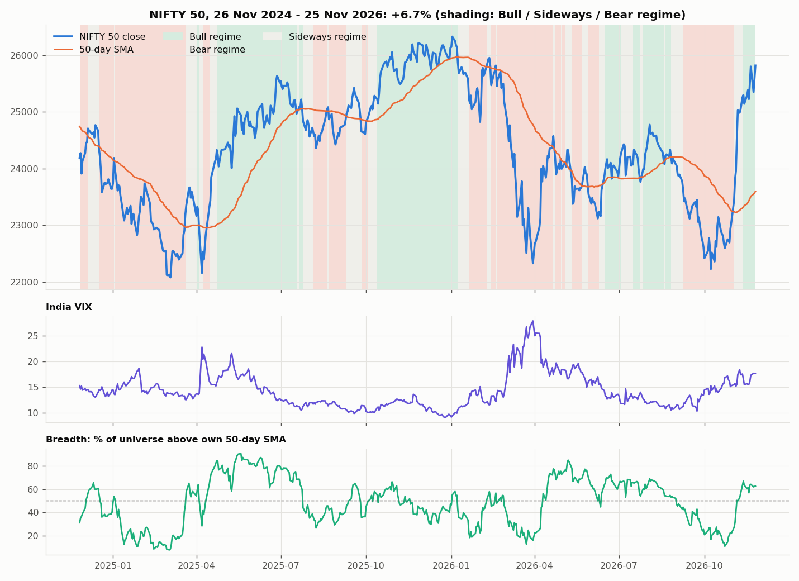

| Index | 2Y return % | 1Y return % | 2Y max DD % | Ann. vol % |
|---|---|---|---|---|
| NIFTY 50 | 6.7 | -1.5 | -15.6 | 13.4 |
| NIFTY NEXT 50 | 4.7 | 5.2 | -22.1 | 17.6 |
| NIFTY 100 | 6.7 | -0.3 | -15.0 | 13.7 |
| NIFTY 200 | 7.3 | -0.1 | -14.9 | 14.0 |
| NIFTY 500 | 6.5 | 0.3 | -14.9 | 14.2 |
| NIFTY MIDCAP 100 | 10.1 | 0.9 | -19.4 | 17.6 |
| NIFTY SMALLCAP 100 | 5.3 | 7.0 | -25.4 | 19.7 |
| NIFTY SMALLCAP 250 | 1.5 | 4.8 | -25.7 | 18.5 |
| NIFTY BANK | 22.1 | 7.0 | -18.3 | 15.8 |
| NIFTY IT | -26.9 | -13.8 | -44.0 | 23.9 |
| NIFTY AUTO | 23.1 | 4.1 | -17.8 | 20.4 |
| NIFTY PHARMA | 31.9 | 26.7 | -15.9 | 15.4 |
| NIFTY FMCG | -13.3 | -9.6 | -26.9 | 14.8 |
| NIFTY METAL | 29.9 | 12.6 | -17.5 | 23.0 |
| NIFTY REALTY | -8.5 | 3.4 | -41.8 | 27.4 |
| NIFTY ENERGY | -0.1 | 2.0 | -21.1 | 17.4 |
| NIFTY FINANCIAL SERVICES | 19.6 | 3.5 | -17.4 | 16.4 |
| NIFTY PSU BANK | 41.3 | 12.2 | -21.3 | 23.1 |
| NIFTY CONSUMER DURABLES | -3.9 | 1.5 | -23.8 | 20.0 |
| NIFTY MEDIA | -14.0 | 15.4 | -39.9 | 23.6 |
| NIFTY OIL & GAS | 4.5 | -6.5 | -16.6 | 17.3 |
| NIFTY HEALTHCARE INDEX | 27.0 | 19.0 | -15.9 | 14.8 |

- India VIX averaged 14.2, ranged 9.2–27.9 (peak 2026-03-30), last 17.7.
- Breadth (share of universe above its own 50-day SMA) averaged 49.1%, from 7.9% to 90.5%.
- Regime (NIFTY vs rising/falling 50-day SMA): Bear 42.9% · Bull 35.3% · Sideways 21.8% of sessions.
- Phases: a slide to ~22,100 into Mar 2025; a rally to ~26,300 by Dec 2025; a sharp fall to ~22,300 in Mar 2026 with VIX at 27.9;
  a range through mid-2026; a fall to ~22,200 in Oct 2026 and a fast rebound to 25,819 by 25 Nov 2026.
- Banks led (NIFTY BANK +22.1%); IT was the worst sector. Small caps had the deepest drawdowns (−25%).

Example stock charts with EMA 20/50, RSI 14 and volume:
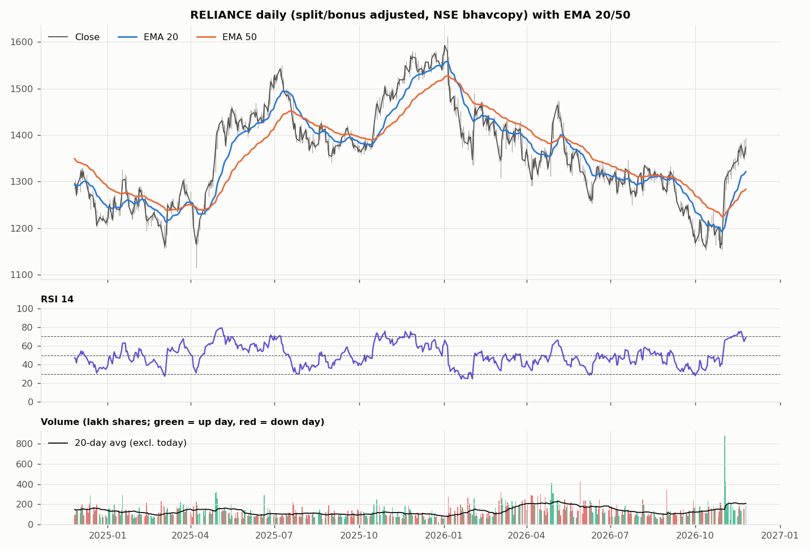
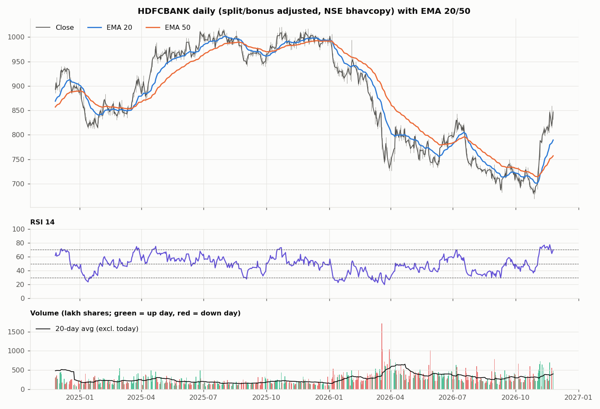
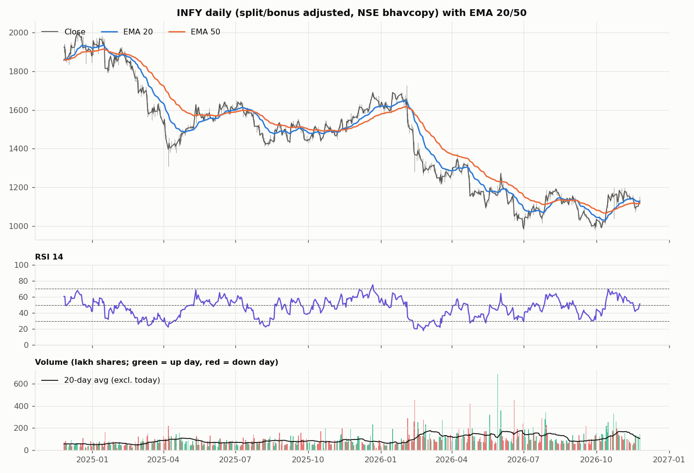
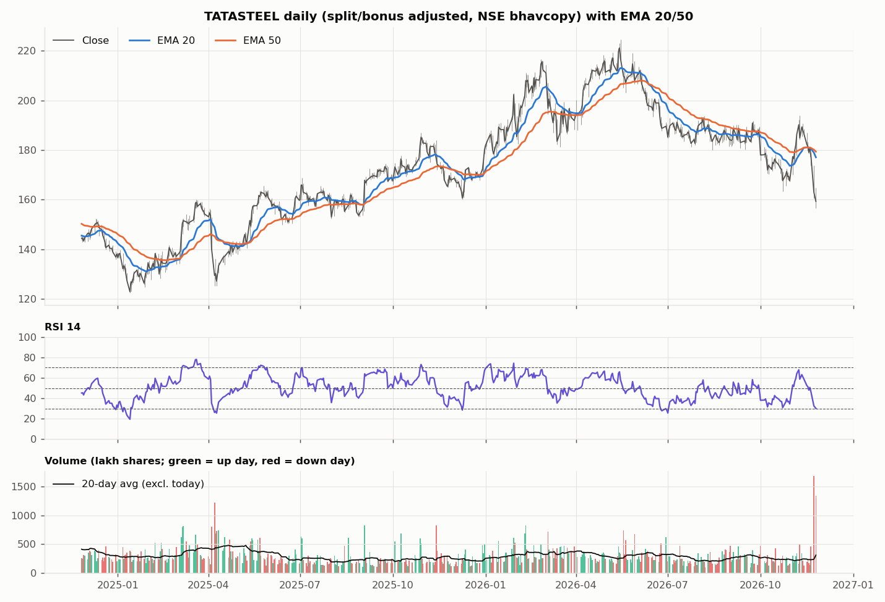

---

## Section 3 — Traditional strategy results (A–G)

Exact definitions are in `PREREGISTRATION.md`. Results below are trade-level, one position per stock per strategy,
after all costs; "edge vs random" subtracts the unconditional-entry baseline in the same weeks.

**Full 2 years (all strategies, no market filter)**

| strategy | trades | wins | losses | win % | avg win % | avg loss % | avg R | win/loss size | PF | max DD (R) | avg hold | avg net % | edge vs random R | edge 5th pct |
|---|---|---|---|---|---|---|---|---|---|---|---|---|---|---|
| A Trend Pullback | 1898 | 707.00 | 1,191 | 37.25 | 6.09 | -5.50 | -0.21 | 1.11 | 0.66 | 434.65 | 10.75 | -1.18 | -0.00 | -0.05 |
| B Breakout Retest | 1193 | 410.00 | 783.00 | 34.37 | 6.01 | -5.69 | -0.27 | 1.06 | 0.55 | 339.52 | 10.70 | -1.67 | -0.04 | -0.10 |
| C Momentum | 3689 | 1,229 | 2,460 | 33.32 | 7.95 | -6.05 | -0.24 | 1.31 | 0.66 | 955.75 | 13.44 | -1.39 | -0.01 | -0.04 |
| D Support Reversal | 1240 | 447.00 | 793.00 | 36.05 | 6.38 | -5.32 | -0.23 | 1.20 | 0.68 | 345.67 | 10.48 | -1.10 | -0.00 | -0.06 |
| E Volatility Breakout | 1363 | 407.00 | 956.00 | 29.86 | 7.69 | -5.92 | -0.33 | 1.30 | 0.55 | 485.89 | 12.38 | -1.86 | -0.05 | -0.10 |
| F Relative Strength | 1354 | 448.00 | 906.00 | 33.09 | 8.53 | -6.53 | -0.23 | 1.31 | 0.65 | 332.22 | 13.08 | -1.55 | 0.01 | -0.05 |
| G Volume & Delivery | 1509 | 570.00 | 939.00 | 37.77 | 5.98 | -5.35 | -0.21 | 1.12 | 0.68 | 339.30 | 10.48 | -1.07 | -0.01 | -0.05 |
| H1 Quiet Pullback | 1866 | 637.00 | 1,229 | 34.14 | 6.18 | -5.44 | -0.26 | 1.14 | 0.59 | 514.59 | 10.90 | -1.47 | -0.03 | -0.07 |
| H2 RS Squeeze Breakout | 704 | 235.00 | 469.00 | 33.38 | 7.72 | -6.29 | -0.27 | 1.23 | 0.62 | 200.65 | 12.80 | -1.61 | 0.03 | -0.03 |
| H3 Higher-Lows Compression Breakout | 706 | 226.00 | 480.00 | 32.01 | 6.69 | -5.74 | -0.31 | 1.17 | 0.55 | 226.80 | 12.85 | -1.76 | -0.05 | -0.13 |
| H4 RSI Recovery at EMA50 | 1758 | 616.00 | 1,142 | 35.04 | 6.16 | -5.80 | -0.28 | 1.06 | 0.57 | 521.09 | 10.50 | -1.61 | -0.04 | -0.09 |
| H5 Sector-Led Consolidation Breakout | 999 | 303.00 | 696.00 | 30.33 | 6.35 | -5.45 | -0.34 | 1.17 | 0.51 | 372.77 | 12.89 | -1.87 | -0.05 | -0.11 |
| H6 ATR Contraction Strong Close | 572 | 165.00 | 407.00 | 28.85 | 7.57 | -5.91 | -0.37 | 1.28 | 0.52 | 213.34 | 12.16 | -2.02 | -0.02 | -0.10 |
| H7 Failed Breakdown | 3874 | 1,472 | 2,402 | 38.00 | 6.46 | -5.49 | -0.18 | 1.18 | 0.72 | 834.07 | 10.82 | -0.95 | -0.03 | -0.07 |
| H8 Gap-and-Hold with Delivery | 75 | 46.00 | 29.00 | 61.33 | 9.90 | -5.36 | 0.64 | 1.85 | 2.93 | 7.88 | 16.31 | 4.00 | 0.36 | 0.07 |
| H9 Strength in Falling Market | 888 | 279.00 | 609.00 | 31.42 | 9.11 | -6.47 | -0.21 | 1.41 | 0.65 | 194.67 | 12.45 | -1.57 | 0.12 | 0.01 |
| H10 Oversold in Uptrend | 3893 | 2,015 | 1,878 | 51.76 | 1.90 | -3.44 | -0.07 | 0.55 | 0.59 | 310.89 | 4.58 | -0.68 | 0.09 | 0.05 |
| H11 Accumulation on Down Day | 1350 | 559.00 | 791.00 | 41.41 | 5.92 | -5.12 | -0.15 | 1.16 | 0.82 | 210.40 | 10.81 | -0.55 | 0.09 | 0.05 |
| H12 New High in Calm Market | 800 | 259.00 | 541.00 | 32.38 | 8.02 | -6.06 | -0.26 | 1.32 | 0.63 | 209.15 | 13.42 | -1.50 | 0.06 | -0.02 |
| R1 Leader Dip | 864 | 353.00 | 511.00 | 40.86 | 2.21 | -2.90 | -0.06 | 0.76 | 0.53 | 79.93 | 3.03 | -0.81 | 0.08 | 0.01 |
| R2 Oversold Leader | 1631 | 906.00 | 725.00 | 55.55 | 2.12 | -3.81 | -0.01 | 0.56 | 0.70 | 79.18 | 4.45 | -0.51 | 0.15 | 0.07 |
| R4 Oversold with Delivery Support | 2881 | 1,505 | 1,376 | 52.24 | 1.82 | -3.33 | -0.09 | 0.55 | 0.60 | 269.91 | 4.52 | -0.64 | 0.07 | 0.05 |

**Most recent 1 year (signals from 2025-11-26)**

| strategy | trades | wins | losses | win % | avg win % | avg loss % | avg R | win/loss size | PF | max DD (R) | avg hold | avg net % | edge vs random R | edge 5th pct |
|---|---|---|---|---|---|---|---|---|---|---|---|---|---|---|
| A Trend Pullback | 933 | 325.00 | 608.00 | 34.83 | 6.51 | -5.49 | -0.25 | 1.19 | 0.63 | 255.25 | 10.35 | -1.31 | 0.01 | -0.05 |
| B Breakout Retest | 601 | 197.00 | 404.00 | 32.78 | 5.80 | -5.62 | -0.30 | 1.03 | 0.50 | 193.10 | 10.54 | -1.88 | -0.07 | -0.15 |
| C Momentum | 1833 | 658.00 | 1,175 | 35.90 | 8.24 | -5.88 | -0.17 | 1.40 | 0.79 | 395.98 | 13.43 | -0.81 | 0.03 | -0.02 |
| D Support Reversal | 733 | 262.00 | 471.00 | 35.74 | 6.83 | -5.32 | -0.23 | 1.28 | 0.71 | 238.44 | 10.00 | -0.98 | -0.04 | -0.11 |
| E Volatility Breakout | 632 | 195.00 | 437.00 | 30.85 | 7.50 | -5.90 | -0.32 | 1.27 | 0.57 | 234.74 | 12.11 | -1.76 | -0.05 | -0.11 |
| F Relative Strength | 656 | 228.00 | 428.00 | 34.76 | 9.49 | -6.31 | -0.14 | 1.50 | 0.80 | 123.80 | 12.97 | -0.82 | 0.07 | -0.03 |
| G Volume & Delivery | 762 | 299.00 | 463.00 | 39.24 | 6.05 | -5.12 | -0.17 | 1.18 | 0.76 | 152.90 | 10.15 | -0.74 | 0.01 | -0.05 |
| H1 Quiet Pullback | 936 | 328.00 | 608.00 | 35.04 | 6.74 | -5.49 | -0.23 | 1.23 | 0.66 | 239.82 | 10.69 | -1.20 | 0.01 | -0.04 |
| H2 RS Squeeze Breakout | 314 | 113.00 | 201.00 | 35.99 | 7.70 | -6.47 | -0.25 | 1.19 | 0.67 | 90.95 | 12.54 | -1.37 | 0.02 | -0.08 |
| H3 Higher-Lows Compression Breakout | 348 | 112.00 | 236.00 | 32.18 | 6.90 | -5.81 | -0.32 | 1.19 | 0.56 | 120.89 | 11.99 | -1.72 | -0.05 | -0.16 |
| H4 RSI Recovery at EMA50 | 891 | 314.00 | 577.00 | 35.24 | 6.48 | -5.88 | -0.29 | 1.10 | 0.60 | 289.82 | 10.42 | -1.52 | -0.11 | -0.16 |
| H5 Sector-Led Consolidation Breakout | 538 | 172.00 | 366.00 | 31.97 | 6.60 | -5.21 | -0.28 | 1.27 | 0.60 | 181.90 | 13.02 | -1.43 | -0.03 | -0.11 |
| H6 ATR Contraction Strong Close | 230 | 73.00 | 157.00 | 31.74 | 7.36 | -5.66 | -0.32 | 1.30 | 0.60 | 76.58 | 11.92 | -1.53 | 0.03 | -0.10 |
| H7 Failed Breakdown | 2173 | 889.00 | 1,284 | 40.91 | 7.08 | -5.48 | -0.11 | 1.29 | 0.89 | 384.82 | 10.45 | -0.34 | -0.04 | -0.09 |
| H8 Gap-and-Hold with Delivery | 53 | 30.00 | 23.00 | 56.60 | 9.92 | -5.50 | 0.55 | 1.80 | 2.35 | 6.78 | 15.47 | 3.23 | 0.20 | -0.23 |
| H9 Strength in Falling Market | 516 | 148.00 | 368.00 | 28.68 | 10.43 | -6.54 | -0.31 | 1.59 | 0.64 | 165.87 | 11.75 | -1.67 | 0.04 | -0.05 |
| H10 Oversold in Uptrend | 1882 | 1,011 | 871.00 | 53.72 | 1.86 | -3.39 | -0.09 | 0.55 | 0.64 | 174.54 | 4.40 | -0.57 | 0.06 | 0.04 |
| H11 Accumulation on Down Day | 626 | 248.00 | 378.00 | 39.62 | 6.00 | -4.99 | -0.18 | 1.20 | 0.79 | 127.95 | 10.19 | -0.63 | 0.08 | 0.02 |
| H12 New High in Calm Market | 496 | 163.00 | 333.00 | 32.86 | 8.43 | -6.19 | -0.25 | 1.36 | 0.67 | 126.50 | 13.49 | -1.38 | 0.02 | -0.06 |
| R1 Leader Dip | 524 | 202.00 | 322.00 | 38.55 | 2.02 | -3.08 | -0.15 | 0.66 | 0.41 | 80.17 | 3.08 | -1.11 | 0.03 | -0.02 |
| R2 Oversold Leader | 809 | 478.00 | 331.00 | 59.09 | 2.03 | -3.75 | -0.05 | 0.54 | 0.78 | 56.15 | 4.21 | -0.34 | 0.11 | 0.07 |
| R4 Oversold with Delivery Support | 1380 | 740.00 | 640.00 | 53.62 | 1.78 | -3.33 | -0.09 | 0.53 | 0.62 | 132.92 | 4.37 | -0.59 | 0.06 | 0.03 |

The market filter (NIFTY > SMA50 and breadth ≥ 50%) made almost every strategy **worse** in Development:

| strategy | trades | avg_R | edge_R | edge_lo90 |
|---|---|---|---|---|
| A Trend Pullback | 620 | -0.226 | -0.067 | -0.175 |
| B Breakout Retest | 453 | -0.288 | -0.057 | -0.159 |
| C Momentum | 1376 | -0.375 | -0.084 | -0.136 |
| D Support Reversal | 137 | -0.319 | 0.071 | -0.098 |
| E Volatility Breakout | 548 | -0.397 | -0.051 | -0.147 |
| F Relative Strength | 409 | -0.304 | -0.100 | -0.211 |
| G Volume & Delivery | 523 | -0.364 | -0.112 | -0.192 |
| H1 Quiet Pullback | 617 | -0.320 | -0.103 | -0.167 |
| H2 RS Squeeze Breakout | 262 | -0.329 | 0.017 | -0.086 |
| H3 Higher-Lows Compression Breakout | 285 | -0.331 | -0.063 | -0.201 |
| H4 RSI Recovery at EMA50 | 441 | -0.331 | -0.028 | -0.124 |
| H5 Sector-Led Consolidation Breakout | 346 | -0.519 | -0.112 | -0.218 |
| H6 ATR Contraction Strong Close | 292 | -0.456 | -0.112 | -0.220 |
| H7 Failed Breakdown | 758 | -0.291 | -0.029 | -0.082 |
| H8 Gap-and-Hold with Delivery | 6 | 1.426 | 0.941 |  |
| H9 Strength in Falling Market | 33 | -1.176 | -0.632 |  |
| H10 Oversold in Uptrend | 952 | -0.157 | -0.004 | -0.051 |
| H11 Accumulation on Down Day | 514 | -0.148 | 0.051 | -0.025 |
| H12 New High in Calm Market | 251 | -0.386 | 0.095 | -0.058 |

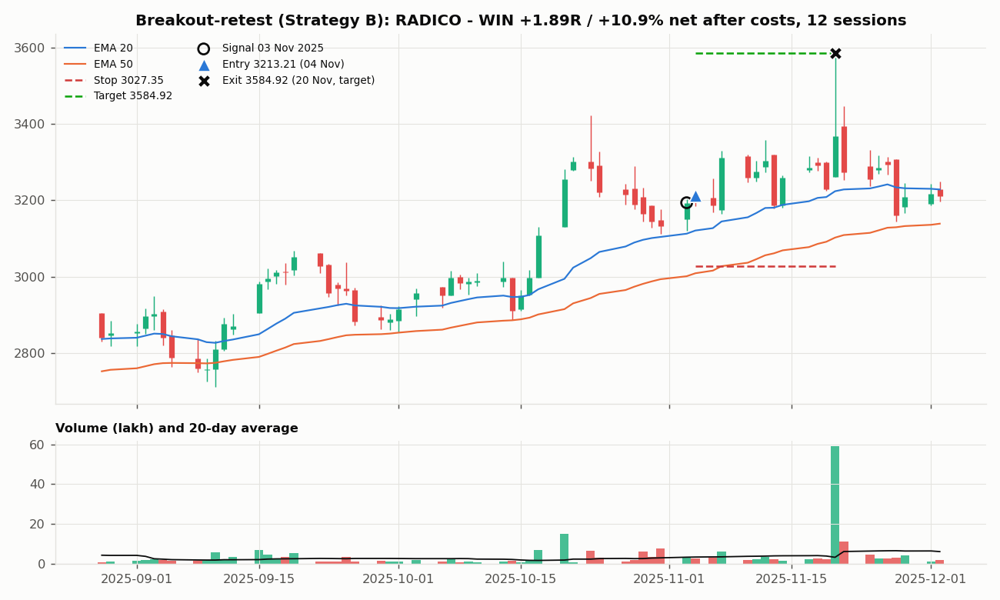
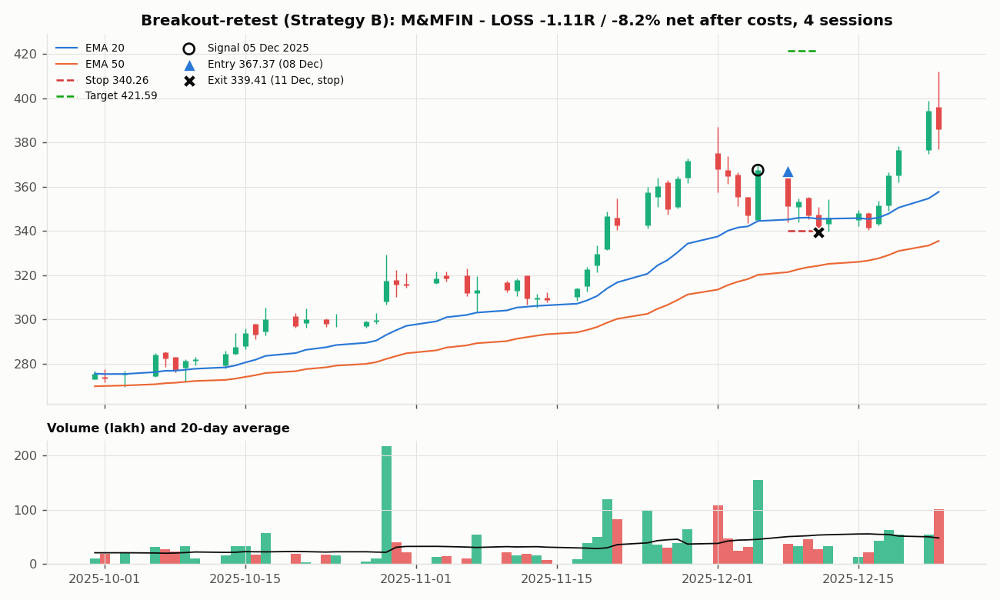

---

## Section 4 — New pattern discovery

Twelve new hypotheses (H1–H12) were fixed in advance, each with one definition — no grid search was used for selection.
Exit-rule-independent view (return from next open over 5/10/20 sessions minus the same-day universe average, before costs):

| strategy | events | per_1000_stock_days | excess_5d_mean | excess_5d_hit | excess_10d_mean | excess_10d_hit | excess_20d_mean | excess_20d_hit |
|---|---|---|---|---|---|---|---|---|
| H8 Gap-and-Hold with Delivery | 81 | 0.38 | 0.48 | 0.51 | 0.69 | 0.53 | 0.10 | 0.48 |
| R3 Gap-and-Hold with Delivery | 81 | 0.38 | 0.48 | 0.51 | 0.69 | 0.53 | 0.10 | 0.48 |
| H11 Accumulation on Down Day | 1803 | 8.38 | 0.30 | 0.50 | 0.46 | 0.51 | 0.52 | 0.52 |
| H12 New High in Calm Market | 1666 | 7.74 | 0.03 | 0.49 | 0.39 | 0.48 | 0.63 | 0.48 |
| H2 RS Squeeze Breakout | 1046 | 4.86 | -0.20 | 0.47 | 0.25 | 0.51 | 0.23 | 0.47 |
| R4 Oversold with Delivery Support | 6465 | 30.04 | 0.19 | 0.51 | 0.23 | 0.49 | 0.29 | 0.49 |
| R2 Oversold Leader | 4441 | 20.64 | 0.18 | 0.50 | 0.21 | 0.49 | 0.13 | 0.49 |
| H10 Oversold in Uptrend | 10358 | 48.13 | 0.11 | 0.50 | 0.07 | 0.48 | 0.09 | 0.48 |
| C Momentum | 7096 | 32.97 | -0.01 | 0.47 | 0.07 | 0.47 | -0.12 | 0.45 |
| H5 Sector-Led Consolidation Breakout | 1318 | 6.12 | -0.15 | 0.47 | 0.04 | 0.48 | -0.56 | 0.44 |
| H3 Higher-Lows Compression Breakout | 984 | 4.57 | -0.17 | 0.45 | 0.04 | 0.48 | -0.17 | 0.45 |
| E Volatility Breakout | 1846 | 8.58 | -0.21 | 0.43 | 0.02 | 0.46 | -0.06 | 0.46 |
| H6 ATR Contraction Strong Close | 640 | 2.97 | -0.10 | 0.46 | 0.01 | 0.45 | 0.15 | 0.45 |
| A Trend Pullback | 2985 | 13.87 | -0.05 | 0.46 | 0.01 | 0.48 | -0.00 | 0.48 |
| G Volume & Delivery | 2051 | 9.53 | -0.07 | 0.47 | 0.00 | 0.47 | -0.12 | 0.47 |
| B Breakout Retest | 2402 | 11.16 | -0.01 | 0.48 | -0.05 | 0.47 | -0.14 | 0.46 |
| D Support Reversal | 1874 | 8.71 | -0.03 | 0.46 | -0.07 | 0.45 | 0.06 | 0.46 |
| H7 Failed Breakdown | 7066 | 32.83 | -0.13 | 0.46 | -0.12 | 0.46 | -0.02 | 0.46 |
| H1 Quiet Pullback | 2942 | 13.67 | -0.18 | 0.45 | -0.30 | 0.45 | -0.43 | 0.45 |
| H4 RSI Recovery at EMA50 | 2257 | 10.49 | -0.22 | 0.45 | -0.31 | 0.45 | -0.11 | 0.47 |
| F Relative Strength | 2399 | 11.15 | -0.19 | 0.47 | -0.40 | 0.45 | -0.48 | 0.45 |
| H9 Strength in Falling Market | 2161 | 10.04 | -0.26 | 0.45 | -0.68 | 0.43 | -0.95 | 0.45 |
| R1 Leader Dip | 2161 | 10.04 | -0.26 | 0.45 | -0.68 | 0.43 | -0.95 | 0.45 |

### The one that held up: Gap-and-Hold with Delivery (H8, re-tested as R3)

**Market behaviour.** A stock opens ≥ 2% above yesterday's close (news or overnight demand), does **not** give the gap back
(close ≥ open, close in the top 40% of the range), on ≥ 2× normal volume — and, unusually for gap days, a **higher-than-normal
share of the volume is taken into delivery**. Gap days are usually dominated by intraday traders (delivery % falls); a gap
where delivery % rises suggests buyers who intend to hold. This is a hypothesis about behaviour, not proof of institutional intent.

**Exact conditions (day t close, all data ≤ t):**
`O_t ≥ 1.02·C_{t-1}` · `C_t ≥ O_t` · `(C_t−L_t)/(H_t−L_t) ≥ 0.6` · `V_t ≥ 2·mean(V_{t-20..t-1})` · `Deliv%_t ≥ mean(Deliv%_{t-20..t-1})`

**Frequency.** 0.38 per 1,000 stock-days — about 3 trades a month across ~440 stocks; it clusters on market-wide gap-up days
(13 signals on 5 Nov 2026, 9 on 8 Apr 2026, 6 on 3 Feb 2026).

**Results by group (Full 2Y, avg R):**

| group | count | mean |
|---|---|---|
| Large | 24 | 0.82 |
| Mid | 24 | 0.55 |
| Small | 27 | 0.56 |
| Bear | 44 | 0.46 |
| Bull | 13 | 0.49 |
| Sideways | 18 | 1.20 |
| open_at_end | 14 | 1.54 |
| stop | 11 | -1.14 |
| stop_gap | 3 | -1.03 |
| time | 37 | 1.19 |
| trail_stop | 10 | -0.19 |

**Robustness (not used for selection).** Of 108 neighbouring parameter sets (gap 1.5/2/3%, volume 1.5/2/3×, close location
0.5/0.6/0.7, delivery filter on/off, exit E1/E2), 84% had positive average R and 55% were positive in all three
periods. Median avg R with the delivery filter: +0.58R; without it: +0.06R. The delivery condition is what carries the result.

**When it fails / caveats.**
- Gaps that reverse within days hit the 2-ATR stop: 14 of 75 trades were stopped (avg −1.1R).
- **The Test period is thin.** 13 of its 19 trades came from one day (5 Nov 2026) and were still open at the data end,
  marked to the last close. Test closed trades only: 5 trades, −0.16R. Excluding the 5 Nov cluster from all periods:
  62 trades, +0.51R, 90% week-bootstrap interval +0.11R to +0.83R.
- Walk-forward could not evaluate it (it needs ≥ 30 trades in a 120-session training window; it produced 2 OOS trades).
- Signals cluster on the same days, so trades are correlated; the portfolio cap of 5 positions limits this.

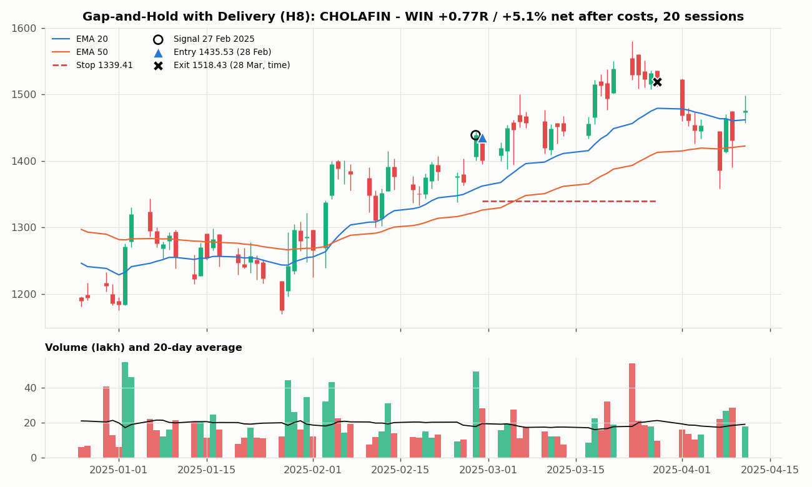
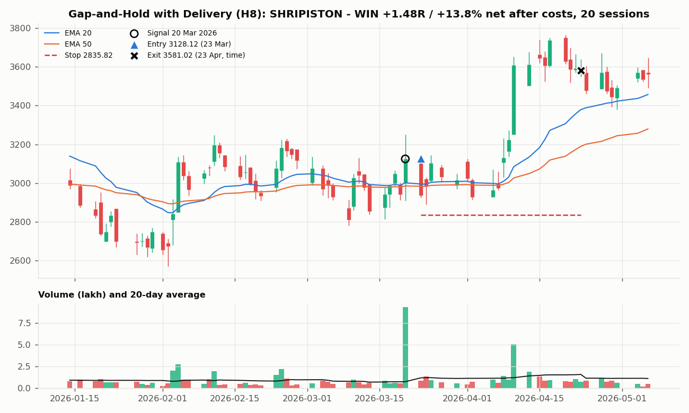
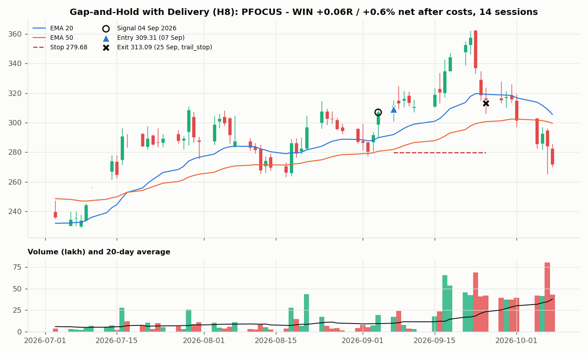
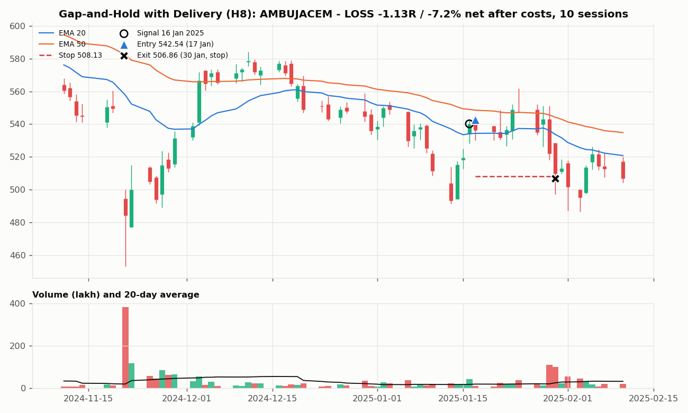
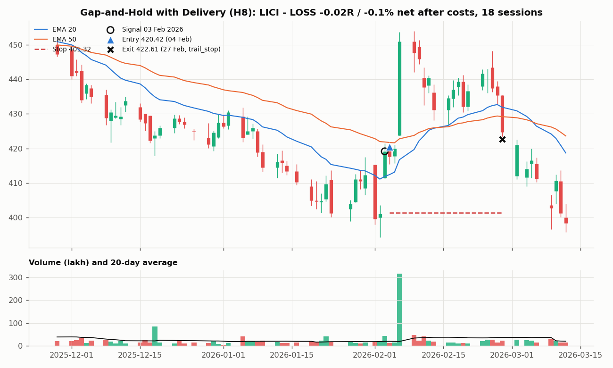
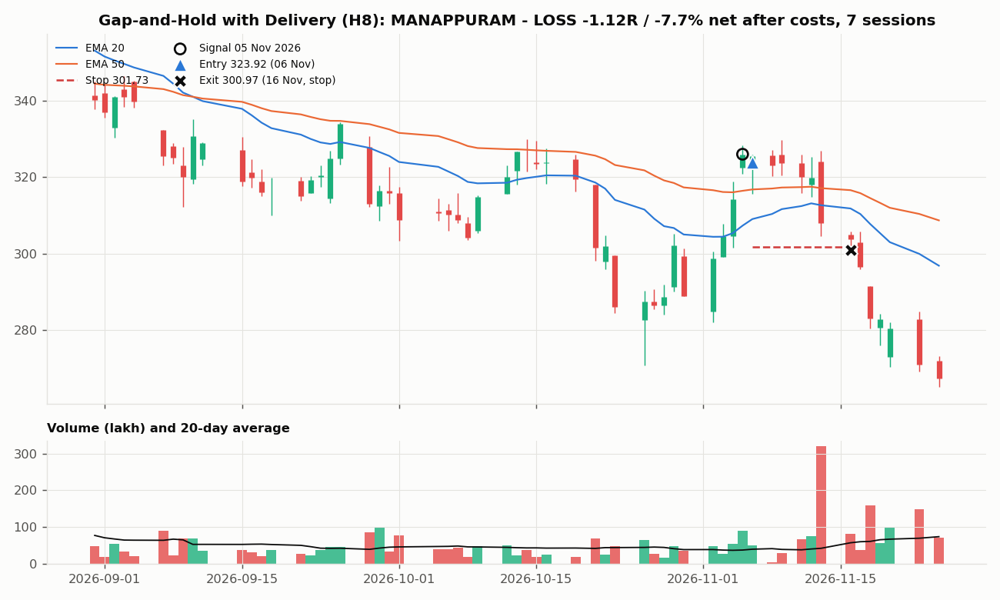

### Relative edge without absolute profit: Oversold Leader (R2)

`C > SMA200` · `RSI(2) < 10` · RS percentile ≥ 0.7, exit on first close above SMA5 (max 10 sessions, 2.5-ATR stop).
Beat random entries by +0.19 / +0.07 / +0.10R in Development / Validation / Test with the lower bound above zero each time —
the most consistent *relative* signal found — but net −0.07R / −0.04R in Validation / Test because the market itself fell.
Before costs it earned +0.14R. In a rising market it may turn positive; that is untested.

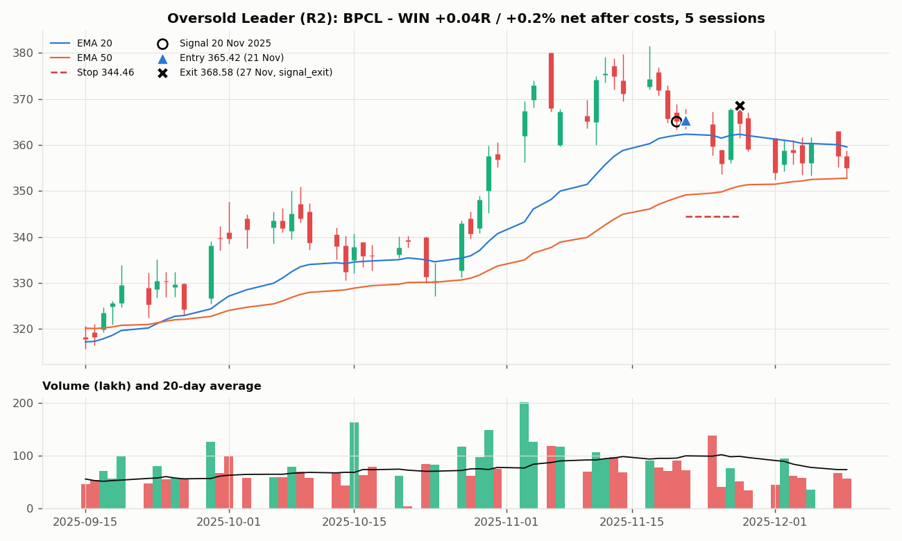
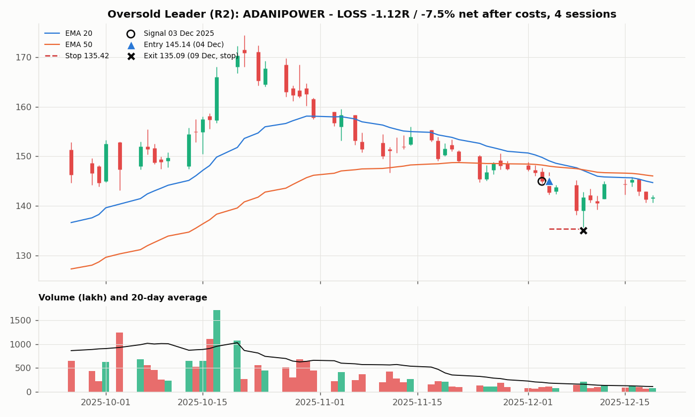

---

## Section 5 — New strategy candidates (rules)

Only one candidate is put forward, and only for paper trading.

**Gap-and-Hold with Delivery (research watch)**
| Item | Rule |
|---|---|
| Market condition | Any; worked in Bull, Sideways and Bear regimes (no market filter — the tested filter hurt) |
| Stock selection | NSE EQ series, top-500 market cap, close ≥ ₹20, 20-day median turnover ≥ ₹5 crore, ≥ 250 sessions history |
| Entry | Conditions above at day t close → buy at day t+1 open. Skip if it opens > 2% above day t close or at/below the stop |
| Stop-loss | Day t close − 2 × ATR14; skip if that is > 10% away |
| Exit | Trail the stop 3 × ATR14 below the highest close; exit at the close of session 20 at the latest |
| Target | None in the rule. A 2R level is shown for reference only (fixed 2R target version: +0.50R vs +0.64R trailing) |
| Position size | 1% of current equity ÷ (entry − stop), capped by cash and 20% of equity; ≤ 5 open; ≤ 2 per sector |
| Holding period | average 16.3 sessions (max 20) |
| Avoid | Stocks with a corporate action inside the last 40 sessions; days the stock closed at its upper band; adding a second position in the same stock |

**Oversold Leader** is documented above but **not** recommended: negative after costs in both held-out periods.

---

## Section 6 — Backtesting results (all metrics)

Chronological split: Development 2024-11-26 → 2026-02-03, Validation 2026-02-04 → 2026-07-02, Test 2026-07-03 → 2026-11-23.

**Development**

| strategy | trades | wins | losses | win % | avg win % | avg loss % | avg R | win/loss size | PF | max DD (R) | avg hold | avg net % | edge vs random R | edge 5th pct |
|---|---|---|---|---|---|---|---|---|---|---|---|---|---|---|
| A Trend Pullback | 1159 | 448.00 | 711.00 | 38.65 | 5.58 | -5.49 | -0.21 | 1.02 | 0.64 | 253.08 | 10.93 | -1.21 | -0.02 | -0.10 |
| B Breakout Retest | 686 | 241.00 | 445.00 | 35.13 | 6.22 | -5.74 | -0.27 | 1.08 | 0.59 | 186.71 | 10.66 | -1.54 | -0.00 | -0.08 |
| C Momentum | 2121 | 625.00 | 1,496 | 29.47 | 7.55 | -6.11 | -0.33 | 1.24 | 0.52 | 723.33 | 13.05 | -2.08 | -0.04 | -0.09 |
| D Support Reversal | 744 | 270.00 | 474.00 | 36.29 | 5.72 | -5.22 | -0.24 | 1.10 | 0.62 | 205.74 | 10.81 | -1.25 | 0.04 | -0.04 |
| E Volatility Breakout | 852 | 232.00 | 620.00 | 27.23 | 7.63 | -5.81 | -0.40 | 1.31 | 0.49 | 337.83 | 12.23 | -2.15 | -0.06 | -0.12 |
| F Relative Strength | 855 | 263.00 | 592.00 | 30.76 | 7.81 | -6.54 | -0.31 | 1.20 | 0.53 | 282.18 | 13.01 | -2.12 | -0.02 | -0.08 |
| G Volume & Delivery | 904 | 314.00 | 590.00 | 34.73 | 5.84 | -5.43 | -0.28 | 1.08 | 0.57 | 267.00 | 10.55 | -1.51 | -0.03 | -0.09 |
| H1 Quiet Pullback | 1124 | 381.00 | 743.00 | 33.90 | 5.57 | -5.31 | -0.28 | 1.05 | 0.54 | 326.55 | 11.08 | -1.62 | -0.05 | -0.09 |
| H2 RS Squeeze Breakout | 455 | 139.00 | 316.00 | 30.55 | 7.31 | -6.02 | -0.32 | 1.21 | 0.53 | 147.82 | 12.77 | -1.95 | 0.03 | -0.04 |
| H3 Higher-Lows Compression Breakout | 410 | 127.00 | 283.00 | 30.98 | 6.40 | -5.60 | -0.32 | 1.14 | 0.51 | 134.96 | 13.20 | -1.88 | -0.04 | -0.15 |
| H4 RSI Recovery at EMA50 | 1107 | 377.00 | 730.00 | 34.06 | 5.80 | -5.68 | -0.29 | 1.02 | 0.53 | 331.92 | 10.50 | -1.77 | -0.01 | -0.06 |
| H5 Sector-Led Consolidation Breakout | 538 | 144.00 | 394.00 | 26.77 | 5.83 | -5.57 | -0.46 | 1.05 | 0.38 | 246.72 | 12.30 | -2.52 | -0.07 | -0.16 |
| H6 ATR Contraction Strong Close | 382 | 102.00 | 280.00 | 26.70 | 7.59 | -6.00 | -0.41 | 1.27 | 0.46 | 165.53 | 12.17 | -2.37 | -0.04 | -0.14 |
| H7 Failed Breakdown | 2277 | 787.00 | 1,490 | 34.56 | 5.57 | -5.44 | -0.26 | 1.02 | 0.54 | 632.32 | 11.08 | -1.64 | -0.04 | -0.09 |
| H8 Gap-and-Hold with Delivery | 30 | 16.00 | 14.00 | 53.33 | 9.87 | -4.93 | 0.44 | 2.00 | 2.29 | 5.68 | 17.70 | 2.97 | 0.41 | 0.02 |
| H9 Strength in Falling Market | 441 | 149.00 | 292.00 | 33.79 | 7.46 | -6.21 | -0.14 | 1.20 | 0.61 | 132.76 | 12.96 | -1.59 | 0.20 | 0.02 |
| H10 Oversold in Uptrend | 2491 | 1,277 | 1,214 | 51.26 | 1.88 | -3.53 | -0.07 | 0.53 | 0.56 | 196.45 | 4.64 | -0.75 | 0.10 | 0.05 |
| H11 Accumulation on Down Day | 839 | 344.00 | 495.00 | 41.00 | 5.72 | -5.12 | -0.16 | 1.12 | 0.78 | 141.03 | 11.11 | -0.67 | 0.09 | 0.02 |
| H12 New High in Calm Market | 379 | 119.00 | 260.00 | 31.40 | 7.38 | -5.88 | -0.29 | 1.26 | 0.57 | 116.81 | 12.96 | -1.72 | 0.13 | 0.00 |
| R1 Leader Dip | 414 | 197.00 | 217.00 | 47.58 | 2.32 | -2.62 | 0.06 | 0.89 | 0.80 | 43.11 | 3.05 | -0.27 | 0.17 | 0.06 |
| R2 Oversold Leader | 1061 | 577.00 | 484.00 | 54.38 | 2.11 | -3.84 | 0.02 | 0.55 | 0.65 | 69.11 | 4.53 | -0.61 | 0.19 | 0.07 |
| R4 Oversold with Delivery Support | 1838 | 947.00 | 891.00 | 51.52 | 1.80 | -3.36 | -0.10 | 0.54 | 0.57 | 182.15 | 4.59 | -0.70 | 0.07 | 0.05 |

**Validation**

| strategy | trades | wins | losses | win % | avg win % | avg loss % | avg R | win/loss size | PF | max DD (R) | avg hold | avg net % | edge vs random R | edge 5th pct |
|---|---|---|---|---|---|---|---|---|---|---|---|---|---|---|
| A Trend Pullback | 346 | 136.00 | 210.00 | 39.31 | 7.86 | -5.56 | -0.09 | 1.41 | 0.91 | 85.38 | 10.94 | -0.29 | 0.09 | -0.02 |
| B Breakout Retest | 267 | 96.00 | 171.00 | 35.96 | 6.63 | -5.82 | -0.21 | 1.14 | 0.64 | 67.98 | 11.36 | -1.35 | -0.06 | -0.20 |
| C Momentum | 923 | 369.00 | 554.00 | 39.98 | 9.26 | -6.12 | -0.05 | 1.51 | 1.01 | 179.92 | 14.88 | 0.03 | 0.04 | -0.02 |
| D Support Reversal | 175 | 73.00 | 102.00 | 41.71 | 8.33 | -6.27 | -0.08 | 1.33 | 0.95 | 70.25 | 10.65 | -0.18 | -0.04 | -0.15 |
| E Volatility Breakout | 195 | 78.00 | 117.00 | 40.00 | 7.92 | -6.04 | -0.08 | 1.31 | 0.87 | 50.34 | 14.45 | -0.45 | 0.00 | -0.12 |
| F Relative Strength | 243 | 100.00 | 143.00 | 41.15 | 11.82 | -6.62 | 0.10 | 1.78 | 1.25 | 59.82 | 14.28 | 0.96 | 0.17 | -0.01 |
| G Volume & Delivery | 327 | 160.00 | 167.00 | 48.93 | 6.74 | -5.56 | 0.04 | 1.21 | 1.16 | 36.01 | 11.12 | 0.46 | 0.09 | 0.01 |
| H1 Quiet Pullback | 327 | 122.00 | 205.00 | 37.31 | 8.06 | -5.82 | -0.15 | 1.39 | 0.82 | 77.23 | 10.83 | -0.64 | 0.00 | -0.07 |
| H2 RS Squeeze Breakout | 96 | 44.00 | 52.00 | 45.83 | 11.02 | -7.06 | 0.13 | 1.56 | 1.32 | 16.18 | 14.70 | 1.23 | 0.14 | -0.10 |
| H3 Higher-Lows Compression Breakout | 165 | 51.00 | 114.00 | 30.91 | 7.93 | -6.16 | -0.32 | 1.29 | 0.58 | 63.84 | 12.99 | -1.80 | -0.10 | -0.27 |
| H4 RSI Recovery at EMA50 | 228 | 97.00 | 131.00 | 42.54 | 7.88 | -5.97 | -0.06 | 1.32 | 0.98 | 55.00 | 11.43 | -0.08 | -0.11 | -0.22 |
| H5 Sector-Led Consolidation Breakout | 254 | 78.00 | 176.00 | 30.71 | 7.10 | -5.44 | -0.30 | 1.31 | 0.58 | 99.39 | 13.86 | -1.59 | -0.11 | -0.24 |
| H6 ATR Contraction Strong Close | 93 | 31.00 | 62.00 | 33.33 | 9.03 | -5.61 | -0.25 | 1.61 | 0.80 | 36.25 | 13.51 | -0.73 | -0.02 | -0.21 |
| H7 Failed Breakdown | 762 | 397.00 | 365.00 | 52.10 | 7.73 | -6.04 | 0.12 | 1.28 | 1.39 | 187.72 | 10.73 | 1.13 | -0.04 | -0.16 |
| H8 Gap-and-Hold with Delivery | 26 | 15.00 | 11.00 | 57.69 | 11.12 | -6.04 | 0.55 | 1.84 | 2.51 | 5.79 | 16.19 | 3.86 | -0.03 | -0.47 |
| H9 Strength in Falling Market | 293 | 107.00 | 186.00 | 36.52 | 11.64 | -6.48 | -0.08 | 1.80 | 1.03 | 105.19 | 12.92 | 0.14 | 0.09 | -0.05 |
| H10 Oversold in Uptrend | 531 | 292.00 | 239.00 | 54.99 | 2.01 | -3.54 | -0.07 | 0.57 | 0.70 | 44.34 | 4.45 | -0.49 | 0.05 | 0.00 |
| H11 Accumulation on Down Day | 302 | 135.00 | 167.00 | 44.70 | 6.67 | -5.11 | -0.06 | 1.31 | 1.06 | 54.51 | 10.67 | 0.16 | 0.14 | 0.03 |
| H12 New High in Calm Market | 223 | 90.00 | 133.00 | 40.36 | 8.62 | -6.05 | -0.06 | 1.42 | 0.96 | 33.79 | 14.98 | -0.13 | 0.01 | -0.14 |
| R1 Leader Dip | 309 | 111.00 | 198.00 | 35.92 | 1.95 | -3.03 | -0.17 | 0.64 | 0.36 | 53.11 | 2.95 | -1.24 | -0.01 | -0.07 |
| R2 Oversold Leader | 233 | 129.00 | 104.00 | 55.36 | 2.27 | -3.84 | -0.07 | 0.59 | 0.74 | 25.97 | 4.15 | -0.45 | 0.07 | 0.01 |
| R4 Oversold with Delivery Support | 383 | 202.00 | 181.00 | 52.74 | 2.04 | -3.55 | -0.09 | 0.57 | 0.64 | 37.78 | 4.49 | -0.60 | 0.03 | -0.03 |

**Test (looked at once)**

| strategy | trades | wins | losses | win % | avg win % | avg loss % | avg R | win/loss size | PF | max DD (R) | avg hold | avg net % | edge vs random R | edge 5th pct |
|---|---|---|---|---|---|---|---|---|---|---|---|---|---|---|
| A Trend Pullback | 393 | 123.00 | 270.00 | 31.30 | 6.00 | -5.47 | -0.35 | 1.10 | 0.50 | 158.05 | 10.06 | -1.88 | -0.03 | -0.10 |
| B Breakout Retest | 240 | 73.00 | 167.00 | 30.42 | 4.49 | -5.43 | -0.37 | 0.83 | 0.36 | 98.64 | 10.05 | -2.41 | -0.13 | -0.22 |
| C Momentum | 645 | 235.00 | 410.00 | 36.43 | 6.94 | -5.75 | -0.19 | 1.21 | 0.69 | 197.29 | 12.65 | -1.13 | 0.04 | -0.05 |
| D Support Reversal | 321 | 104.00 | 217.00 | 32.40 | 6.73 | -5.09 | -0.29 | 1.32 | 0.63 | 163.78 | 9.62 | -1.26 | -0.09 | -0.17 |
| E Volatility Breakout | 316 | 97.00 | 219.00 | 30.70 | 7.63 | -6.16 | -0.32 | 1.24 | 0.55 | 131.90 | 11.50 | -1.93 | -0.05 | -0.14 |
| F Relative Strength | 256 | 85.00 | 171.00 | 33.20 | 6.89 | -6.41 | -0.27 | 1.07 | 0.53 | 94.40 | 12.17 | -2.00 | -0.06 | -0.19 |
| G Volume & Delivery | 278 | 96.00 | 182.00 | 34.53 | 5.20 | -4.91 | -0.25 | 1.06 | 0.56 | 95.45 | 9.51 | -1.42 | -0.05 | -0.13 |
| H1 Quiet Pullback | 415 | 134.00 | 281.00 | 32.29 | 6.18 | -5.48 | -0.31 | 1.13 | 0.54 | 156.27 | 10.49 | -1.72 | -0.02 | -0.10 |
| H2 RS Squeeze Breakout | 153 | 52.00 | 101.00 | 33.99 | 6.03 | -6.74 | -0.36 | 0.90 | 0.46 | 67.26 | 11.69 | -2.40 | -0.04 | -0.18 |
| H3 Higher-Lows Compression Breakout | 131 | 48.00 | 83.00 | 36.64 | 6.12 | -5.63 | -0.24 | 1.09 | 0.63 | 42.29 | 11.56 | -1.32 | -0.01 | -0.19 |
| H4 RSI Recovery at EMA50 | 423 | 142.00 | 281.00 | 33.57 | 5.93 | -6.03 | -0.37 | 0.98 | 0.50 | 186.93 | 10.00 | -2.01 | -0.11 | -0.19 |
| H5 Sector-Led Consolidation Breakout | 207 | 81.00 | 126.00 | 39.13 | 6.56 | -5.08 | -0.11 | 1.29 | 0.83 | 51.08 | 13.26 | -0.52 | 0.08 | -0.04 |
| H6 ATR Contraction Strong Close | 97 | 32.00 | 65.00 | 32.99 | 6.10 | -5.83 | -0.33 | 1.05 | 0.52 | 35.08 | 10.81 | -1.89 | 0.03 | -0.12 |
| H7 Failed Breakdown | 835 | 288.00 | 547.00 | 34.49 | 7.13 | -5.24 | -0.23 | 1.36 | 0.72 | 338.71 | 10.18 | -0.97 | 0.02 | -0.05 |
| H8 Gap-and-Hold with Delivery | 19 | 15.00 | 4.00 | 78.95 | 8.71 | -5.03 | 1.09 | 1.73 | 6.49 | 2.37 | 14.26 | 5.82 | 0.80 | 0.03 |
| H9 Strength in Falling Market | 154 | 23.00 | 131.00 | 14.94 | 7.97 | -7.01 | -0.69 | 1.14 | 0.20 | 115.67 | 10.10 | -4.78 | -0.03 | -0.09 |
| H10 Oversold in Uptrend | 871 | 446.00 | 425.00 | 51.21 | 1.86 | -3.15 | -0.09 | 0.59 | 0.62 | 84.79 | 4.49 | -0.58 | 0.05 | 0.02 |
| H11 Accumulation on Down Day | 209 | 80.00 | 129.00 | 38.28 | 5.50 | -5.13 | -0.21 | 1.07 | 0.66 | 64.26 | 9.81 | -1.06 | 0.04 | -0.04 |
| H12 New High in Calm Market | 198 | 50.00 | 148.00 | 25.25 | 8.48 | -6.40 | -0.43 | 1.32 | 0.45 | 85.56 | 12.55 | -2.65 | -0.03 | -0.17 |
| R1 Leader Dip | 141 | 45.00 | 96.00 | 31.91 | 2.39 | -3.25 | -0.18 | 0.74 | 0.35 | 27.44 | 3.13 | -1.45 | 0.00 | -0.03 |
| R2 Oversold Leader | 337 | 200.00 | 137.00 | 59.35 | 2.07 | -3.66 | -0.04 | 0.57 | 0.83 | 19.02 | 4.42 | -0.26 | 0.10 | 0.06 |
| R4 Oversold with Delivery Support | 660 | 356.00 | 304.00 | 53.94 | 1.75 | -3.11 | -0.08 | 0.56 | 0.66 | 60.45 | 4.38 | -0.49 | 0.07 | 0.04 |

**Cost sensitivity (avg R, Full 2Y)**

| strategy | 2x costs + 25bps slip | base costs | no costs/slippage | zero brokerage |
|---|---|---|---|---|
| A Trend Pullback | -0.351 | -0.215 | -0.055 | -0.172 |
| B Breakout Retest | -0.412 | -0.275 | -0.135 | -0.235 |
| C Momentum | -0.366 | -0.238 | -0.092 | -0.199 |
| D Support Reversal | -0.381 | -0.229 | -0.060 | -0.183 |
| E Volatility Breakout | -0.471 | -0.335 | -0.176 | -0.293 |
| F Relative Strength | -0.351 | -0.226 | -0.093 | -0.190 |
| G Volume & Delivery | -0.346 | -0.206 | -0.047 | -0.161 |
| H1 Quiet Pullback | -0.402 | -0.263 | -0.110 | -0.221 |
| H10 Oversold in Uptrend | -0.213 | -0.073 | 0.062 | -0.038 |
| H11 Accumulation on Down Day | -0.310 | -0.147 | 0.033 | -0.099 |
| H12 New High in Calm Market | -0.390 | -0.261 | -0.120 | -0.223 |
| H2 RS Squeeze Breakout | -0.396 | -0.267 | -0.124 | -0.229 |
| H3 Higher-Lows Compression Breakout | -0.429 | -0.307 | -0.150 | -0.266 |
| H4 RSI Recovery at EMA50 | -0.412 | -0.276 | -0.125 | -0.235 |
| H5 Sector-Led Consolidation Breakout | -0.481 | -0.344 | -0.185 | -0.301 |
| H6 ATR Contraction Strong Close | -0.499 | -0.369 | -0.212 | -0.326 |
| H7 Failed Breakdown | -0.314 | -0.176 | -0.024 | -0.134 |
| H8 Gap-and-Hold with Delivery | 0.475 | 0.641 | 0.786 | 0.679 |
| H9 Strength in Falling Market | -0.359 | -0.215 | -0.054 | -0.173 |
| R1 Leader Dip | -0.208 | -0.060 | 0.071 | -0.025 |
| R2 Oversold Leader | -0.155 | -0.006 | 0.137 | 0.028 |
| R4 Oversold with Delivery Support | -0.226 | -0.093 | 0.033 | -0.058 |

**₹50,000 portfolio — Full 2Y (1% risk, ≤ 5 positions; all strategies)**

| strategy | end_capital | net_return_pct | max_drawdown_pct | trades | profit_factor | sharpe |
|---|---|---|---|---|---|---|
| H8 Gap-and-Hold with Delivery | 57,435 | 14.87 | -7.03 | 44 | 2.02 | 1.07 |
| Benchmark: NIFTYBEES buy-and-hold | 53,704 | 7.41 | -14.77 | 0 |  | 0.38 |
| Benchmark: NIFTYBEES 50-day SMA timing | 51,511 | 3.02 | -13.78 | 0 |  | 0.23 |
| R2 Oversold Leader | 49,235 | -1.53 | -19.68 | 247 | 0.96 | 0.02 |
| G Volume & Delivery | 47,188 | -5.62 | -21.07 | 158 | 0.91 | -0.13 |
| H12 New High in Calm Market | 46,800 | -6.40 | -18.78 | 109 | 0.90 | -0.19 |
| A Trend Pullback | 45,519 | -8.96 | -35.08 | 114 | 0.83 | -0.20 |
| E Volatility Breakout | 44,293 | -11.41 | -23.52 | 61 | 0.67 | -0.32 |
| H9 Strength in Falling Market | 42,323 | -15.35 | -26.50 | 80 | 0.61 | -0.31 |
| R1 Leader Dip | 40,896 | -18.21 | -18.21 | 214 | 0.54 | -1.77 |
| H11 Accumulation on Down Day | 40,871 | -18.26 | -30.24 | 150 | 0.73 | -0.57 |
| C Momentum | 40,242 | -19.52 | -28.96 | 133 | 0.74 | -0.52 |
| H10 Oversold in Uptrend | 40,171 | -19.66 | -27.15 | 363 | 0.70 | -0.57 |
| B Breakout Retest | 38,555 | -22.89 | -31.04 | 156 | 0.65 | -0.76 |
| R4 Oversold with Delivery Support | 37,533 | -24.93 | -32.41 | 365 | 0.63 | -0.70 |
| H2 RS Squeeze Breakout | 37,419 | -25.16 | -35.44 | 117 | 0.50 | -0.63 |
| H4 RSI Recovery at EMA50 | 37,220 | -25.56 | -30.42 | 93 | 0.48 | -0.93 |
| H7 Failed Breakdown | 36,120 | -27.76 | -37.65 | 205 | 0.65 | -1.06 |
| H3 Higher-Lows Compression Breakout | 35,979 | -28.04 | -28.74 | 120 | 0.59 | -1.05 |
| H6 ATR Contraction Strong Close | 35,210 | -29.58 | -36.01 | 113 | 0.49 | -1.32 |
| F Relative Strength | 33,040 | -33.92 | -41.40 | 139 | 0.54 | -1.15 |
| H5 Sector-Led Consolidation Breakout | 32,127 | -35.75 | -39.26 | 142 | 0.44 | -1.60 |
| D Support Reversal | 31,192 | -37.62 | -40.82 | 218 | 0.56 | -1.86 |
| H1 Quiet Pullback | 30,276 | -39.45 | -47.99 | 152 | 0.42 | -1.27 |

**₹50,000 portfolio — sizing comparison, Full 2Y**

| strategy | sizing | end_capital | gross_profit | net_profit | net_return_pct | cagr_pct | max_drawdown_pct | trades | win_rate | profit_factor | sharpe | sortino | max_consecutive_losses | capital_utilisation_pct | total_charges |
|---|---|---|---|---|---|---|---|---|---|---|---|---|---|---|---|
| A Trend Pullback | Risk 1%, up to 5 | 45,519 | 614.81 | -4,481 | -8.96 | -4.60 | -35.08 | 114 | 42.98 | 0.83 | -0.20 | -0.31 | 12 | 73.19 | 1,777 |
| A Trend Pullback | Equal weight, up to 5 | 46,368 | 1,342 | -3,632 | -7.26 | -3.71 | -37.05 | 95 | 44.21 | 0.88 | -0.11 | -0.16 | 11 | 78.67 | 1,873 |
| A Trend Pullback | Risk 1%, one at a time | 50,582 | 1,715 | 581.61 | 1.16 | 0.58 | -12.44 | 22 | 54.55 | 1.11 | 0.10 | 0.15 | 2 | 27.64 | 433.61 |
| A Trend Pullback | Equal weight, one at a time (all-in) | 47,335 | 251.82 | -2,665 | -5.33 | -2.71 | -29.64 | 24 | 45.83 | 0.91 | -0.10 | -0.13 | 7 | 28.57 | 1,336 |
| G Volume & Delivery | Risk 1%, up to 5 | 47,188 | 3,645 | -2,812 | -5.62 | -2.86 | -21.07 | 158 | 39.24 | 0.91 | -0.13 | -0.20 | 13 | 82.71 | 2,122 |
| G Volume & Delivery | Equal weight, up to 5 | 41,131 | -659.07 | -8,869 | -17.74 | -9.33 | -27.30 | 175 | 40.00 | 0.79 | -0.57 | -0.80 | 14 | 78.61 | 2,865 |
| G Volume & Delivery | Risk 1%, one at a time | 49,245 | 836.01 | -754.60 | -1.51 | -0.76 | -13.15 | 30 | 36.67 | 0.89 | -0.08 | -0.12 | 5 | 18.32 | 596.32 |
| G Volume & Delivery | Equal weight, one at a time (all-in) | 30,850 | -13,852 | -19,150 | -38.30 | -21.52 | -45.40 | 47 | 38.30 | 0.59 | -0.78 | -0.94 | 5 | 68.63 | 2,417 |
| H12 New High in Calm Market | Risk 1%, up to 5 | 46,800 | 1,623 | -3,200 | -6.40 | -3.26 | -18.78 | 109 | 37.61 | 0.90 | -0.19 | -0.24 | 10 | 44.73 | 1,607 |
| H12 New High in Calm Market | Equal weight, up to 5 | 50,779 | 6,436 | 779.38 | 1.56 | 0.78 | -21.84 | 108 | 36.11 | 1.02 | 0.13 | 0.16 | 9 | 53.91 | 2,040 |
| H12 New High in Calm Market | Risk 1%, one at a time | 44,928 | -3,730 | -5,072 | -10.14 | -5.23 | -10.85 | 30 | 30.00 | 0.45 | -1.10 | -1.14 | 6 | 8.78 | 450.61 |
| H12 New High in Calm Market | Equal weight, one at a time (all-in) | 23,622 | -23,141 | -26,378 | -52.76 | -31.35 | -58.73 | 25 | 28.00 | 0.33 | -1.04 | -1.10 | 8 | 51.35 | 1,494 |
| H8 Gap-and-Hold with Delivery | Risk 1%, up to 5 | 57,435 | 9,659 | 7,435 | 14.87 | 7.20 | -7.03 | 44 | 56.82 | 2.02 | 1.07 | 1.36 | 7 | 19.16 | 775.46 |
| H8 Gap-and-Hold with Delivery | Equal weight, up to 5 | 62,082 | 14,814 | 12,082 | 24.16 | 11.47 | -11.22 | 43 | 58.14 | 2.24 | 1.13 | 1.41 | 7 | 24.93 | 1,040 |
| H8 Gap-and-Hold with Delivery | Risk 1%, one at a time | 51,360 | 2,202 | 1,360 | 2.72 | 1.36 | -4.58 | 17 | 52.94 | 1.42 | 0.42 | 0.43 | 3 | 7.22 | 292.67 |
| H8 Gap-and-Hold with Delivery | Equal weight, one at a time (all-in) | 68,337 | 21,347 | 18,337 | 36.67 | 16.97 | -27.12 | 16 | 50.00 | 1.88 | 0.75 | 0.80 | 3 | 47.22 | 1,433 |
| R2 Oversold Leader | Risk 1%, up to 5 | 49,235 | 9,364 | -764.86 | -1.53 | -0.77 | -19.68 | 247 | 59.11 | 0.96 | 0.02 | 0.03 | 5 | 72.73 | 3,247 |
| R2 Oversold Leader | Equal weight, up to 5 | 36,692 | 684.50 | -13,308 | -26.62 | -14.38 | -31.39 | 303 | 54.13 | 0.62 | -0.78 | -1.11 | 8 | 72.82 | 4,798 |
| R2 Oversold Leader | Risk 1%, one at a time | 48,817 | -1,063 | -1,183 | -2.37 | -1.19 | -13.69 | 3 | 66.67 | 0.18 | -0.06 | -0.10 | 1 | 29.05 | 61.81 |
| R2 Oversold Leader | Equal weight, one at a time (all-in) | 47,124 | -2,614 | -2,876 | -5.75 | -2.93 | -38.41 | 2 | 50.00 | 0.43 | 0.10 | 0.18 | 1 | 98.50 | 167.98 |
| Benchmark: NIFTYBEES buy-and-hold | all-in | 53,704 | 0.00 | 3,704 | 7.41 | 3.65 | -14.77 | 0 |  |  | 0.38 | 0.59 | 0 | 100.00 | 0.00 |
| Benchmark: NIFTYBEES 50-day SMA timing | all-in | 51,511 | 0.00 | 1,511 | 3.02 | 1.51 | -13.78 | 0 |  |  | 0.23 | 0.31 | 0 | 100.00 | 0.00 |

**₹50,000 portfolio — sizing comparison, Recent 1Y**

| strategy | sizing | end_capital | gross_profit | net_profit | net_return_pct | cagr_pct | max_drawdown_pct | trades | win_rate | profit_factor | sharpe | sortino | max_consecutive_losses | capital_utilisation_pct | total_charges |
|---|---|---|---|---|---|---|---|---|---|---|---|---|---|---|---|
| A Trend Pullback | Risk 1%, up to 5 | 46,429 | -142.77 | -3,571 | -7.14 | -7.16 | -24.19 | 78 | 46.15 | 0.77 | -0.46 | -0.64 | 11 | 68.86 | 1,214 |
| A Trend Pullback | Equal weight, up to 5 | 42,489 | -4,630 | -7,511 | -15.02 | -15.07 | -28.66 | 59 | 40.68 | 0.60 | -0.83 | -1.15 | 11 | 77.76 | 1,088 |
| A Trend Pullback | Risk 1%, one at a time | 49,336 | -465.72 | -664.44 | -1.33 | -1.33 | -10.66 | 4 | 25.00 | 0.11 | -0.15 | -0.26 | 2 | 21.65 | 92.96 |
| A Trend Pullback | Equal weight, one at a time (all-in) | 47,978 | -1,658 | -2,022 | -4.04 | -4.06 | -6.76 | 4 | 25.00 | 0.00 | -0.86 | -0.85 | 3 | 11.31 | 167.56 |
| G Volume & Delivery | Risk 1%, up to 5 | 46,089 | 310.62 | -3,911 | -7.82 | -7.85 | -14.16 | 93 | 40.86 | 0.79 | -0.51 | -0.69 | 6 | 74.14 | 1,480 |
| G Volume & Delivery | Equal weight, up to 5 | 44,948 | 557.55 | -5,052 | -10.10 | -10.14 | -18.96 | 113 | 42.48 | 0.80 | -0.66 | -0.92 | 7 | 78.33 | 2,012 |
| G Volume & Delivery | Risk 1%, one at a time | 48,930 | 326.82 | -1,070 | -2.14 | -2.15 | -3.65 | 29 | 41.38 | 0.82 | -0.43 | -0.64 | 3 | 14.00 | 496.97 |
| G Volume & Delivery | Equal weight, one at a time (all-in) | 46,486 | -2,827 | -3,514 | -7.03 | -7.05 | -10.59 | 5 | 40.00 | 0.25 | -0.72 | -0.74 | 2 | 17.38 | 328.77 |
| H12 New High in Calm Market | Risk 1%, up to 5 | 57,741 | 10,011 | 7,741 | 15.48 | 15.54 | -10.16 | 48 | 41.67 | 1.57 | 1.10 | 1.51 | 9 | 51.67 | 790.04 |
| H12 New High in Calm Market | Equal weight, up to 5 | 61,842 | 14,587 | 11,842 | 23.68 | 23.77 | -13.32 | 49 | 36.73 | 1.62 | 1.28 | 1.69 | 9 | 54.16 | 1,020 |
| H12 New High in Calm Market | Risk 1%, one at a time | 46,641 | -2,661 | -3,359 | -6.72 | -6.74 | -7.00 | 16 | 25.00 | 0.40 | -1.32 | -1.33 | 6 | 8.53 | 231.84 |
| H12 New High in Calm Market | Equal weight, one at a time (all-in) | 27,501 | -20,876 | -22,499 | -45.00 | -45.11 | -46.12 | 14 | 28.57 | 0.08 | -1.65 | -1.60 | 6 | 45.68 | 740.81 |
| H8 Gap-and-Hold with Delivery | Risk 1%, up to 5 | 52,497 | 3,831 | 2,497 | 4.99 | 5.01 | -7.08 | 28 | 50.00 | 1.49 | 0.65 | 0.87 | 7 | 22.36 | 454.49 |
| H8 Gap-and-Hold with Delivery | Equal weight, up to 5 | 53,338 | 4,939 | 3,338 | 6.68 | 6.70 | -10.36 | 28 | 50.00 | 1.47 | 0.62 | 0.85 | 7 | 29.71 | 590.52 |
| H8 Gap-and-Hold with Delivery | Risk 1%, one at a time | 49,295 | -208.31 | -705.29 | -1.41 | -1.42 | -4.43 | 10 | 40.00 | 0.73 | -0.36 | -0.38 | 3 | 7.50 | 174.61 |
| H8 Gap-and-Hold with Delivery | Equal weight, one at a time (all-in) | 52,793 | 4,434 | 2,793 | 5.59 | 5.61 | -25.50 | 10 | 40.00 | 1.21 | 0.33 | 0.38 | 3 | 53.24 | 772.34 |
| R2 Oversold Leader | Risk 1%, up to 5 | 41,216 | -2,208 | -8,784 | -17.57 | -17.62 | -23.44 | 161 | 54.66 | 0.49 | -0.96 | -1.22 | 5 | 72.21 | 2,132 |
| R2 Oversold Leader | Equal weight, up to 5 | 41,751 | -395.94 | -8,249 | -16.50 | -16.55 | -20.74 | 160 | 56.25 | 0.62 | -0.90 | -1.18 | 6 | 69.87 | 2,789 |
| R2 Oversold Leader | Risk 1%, one at a time | 48,182 | 585.51 | -1,818 | -3.64 | -3.65 | -5.42 | 56 | 60.71 | 0.65 | -1.06 | -1.49 | 4 | 10.03 | 779.83 |
| R2 Oversold Leader | Equal weight, one at a time (all-in) | 46,395 | -328.58 | -3,605 | -7.21 | -7.23 | -18.90 | 29 | 41.38 | 0.74 | -0.19 | -0.25 | 4 | 73.73 | 1,515 |
| Benchmark: NIFTYBEES buy-and-hold | all-in | 49,881 | 0.00 | -118.76 | -0.24 | -0.24 | -14.77 | 0 |  |  | 0.02 | 0.03 | 0 | 100.00 | 0.00 |
| Benchmark: NIFTYBEES 50-day SMA timing | all-in | 49,224 | 0.00 | -776.02 | -1.55 | -1.56 | -12.60 | 0 |  |  | -0.23 | -0.26 | 0 | 100.00 | 0.00 |

**Monthly returns (%), ₹50k account**

| month | Benchmark: NIFTYBEES buy-and-hold | H8 Gap-and-Hold with Delivery | R2 Oversold Leader |
|---|---|---|---|
| 2024-11 | -1.4 | 0.0 | 0.3 |
| 2024-12 | -2.0 | 0.0 | -0.1 |
| 2025-01 | -0.6 | -1.1 | -14.9 |
| 2025-02 | -5.5 | -0.4 | -4.1 |
| 2025-03 | 5.9 | 1.1 | 3.4 |
| 2025-04 | 3.3 | 3.0 | 2.2 |
| 2025-05 | 2.2 | 2.8 | 3.4 |
| 2025-06 | 3.1 | 0.7 | 5.8 |
| 2025-07 | -2.5 | 0.0 | 3.7 |
| 2025-08 | -1.1 | 0.4 | -0.3 |
| 2025-09 | 0.5 | -0.2 | 2.0 |
| 2025-10 | 4.9 | 1.9 | 2.3 |
| 2025-11 | 1.9 | 1.4 | -0.9 |
| 2025-12 | -0.4 | -0.8 | 3.7 |
| 2026-01 | -2.9 | -0.6 | -0.4 |
| 2026-02 | -0.5 | -1.8 | -3.4 |
| 2026-03 | -11.1 | -3.1 | -5.9 |
| 2026-04 | 7.3 | 4.7 | 6.3 |
| 2026-05 | -1.5 | -2.9 | 0.9 |
| 2026-06 | 1.5 | -1.2 | 0.9 |
| 2026-07 | 2.1 | 2.8 | 1.4 |
| 2026-08 | -0.9 | -0.2 | -0.2 |
| 2026-09 | -5.9 | 0.0 | -8.2 |
| 2026-10 | 1.7 | -0.2 | -0.8 |
| 2026-11 | 11.8 | 8.4 | 4.1 |

---

## Section 7 — Charts

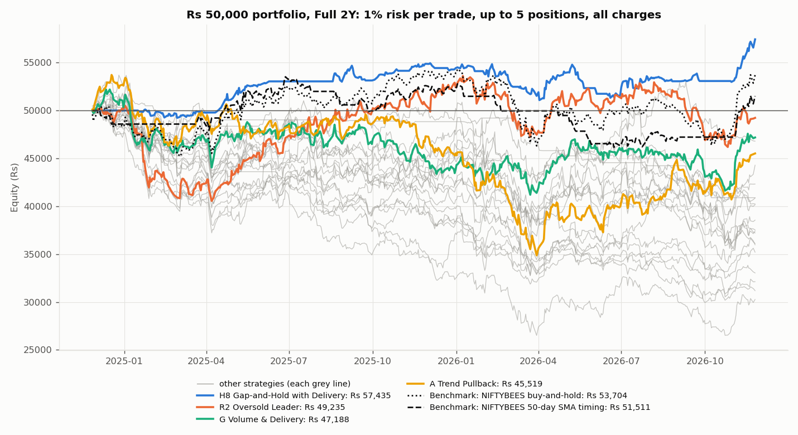
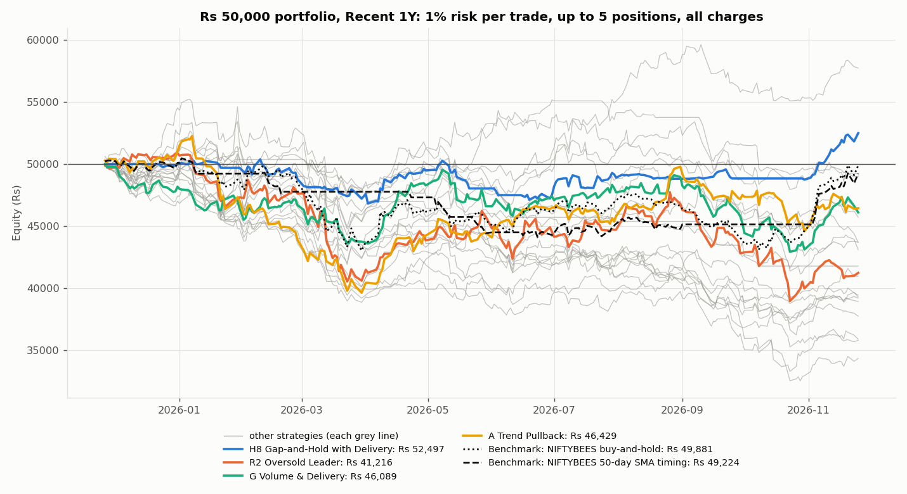
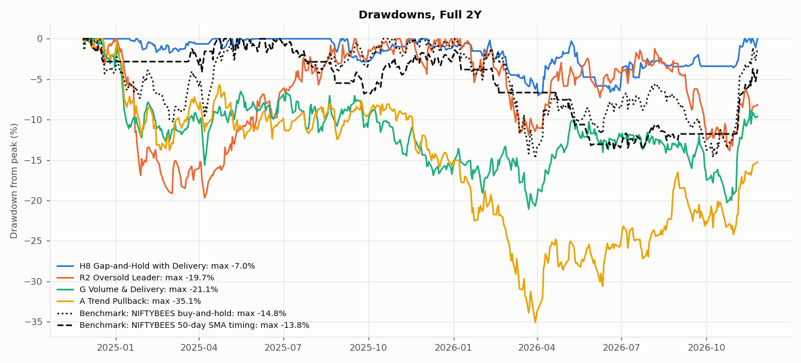
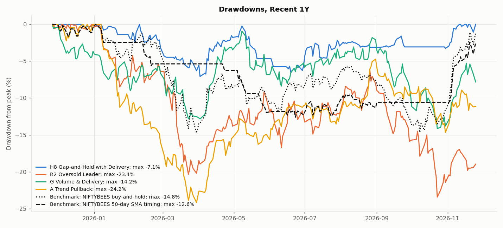
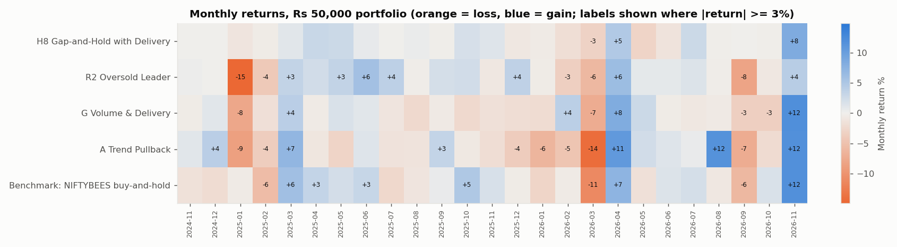
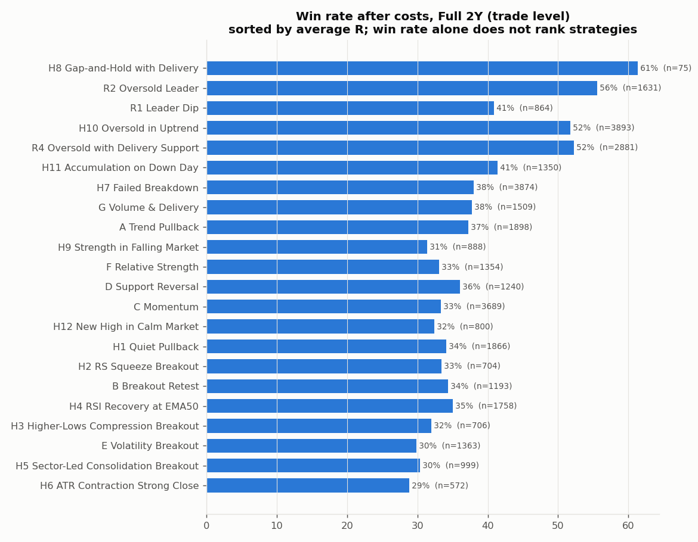
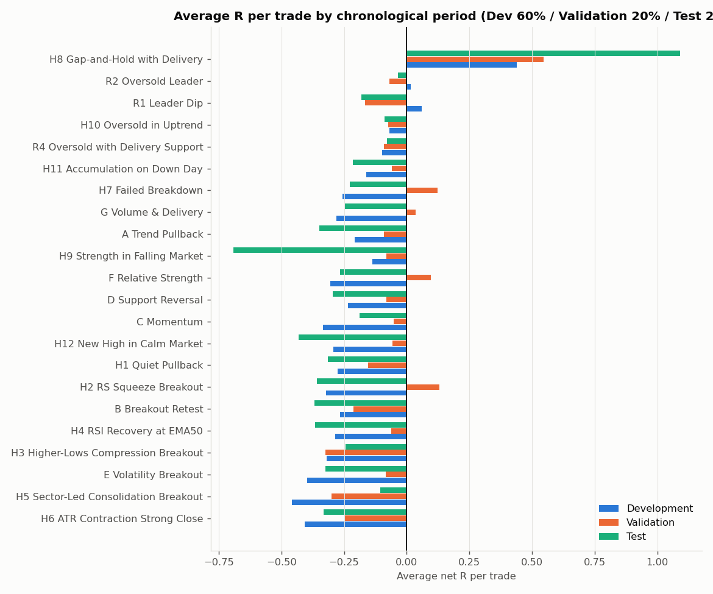
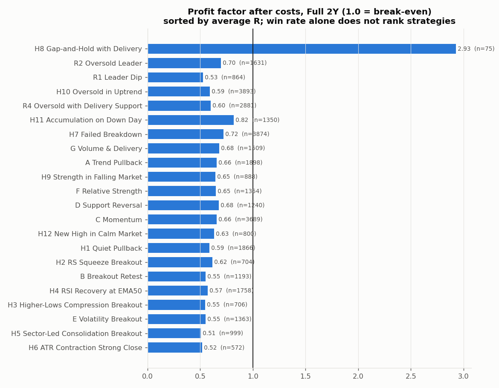
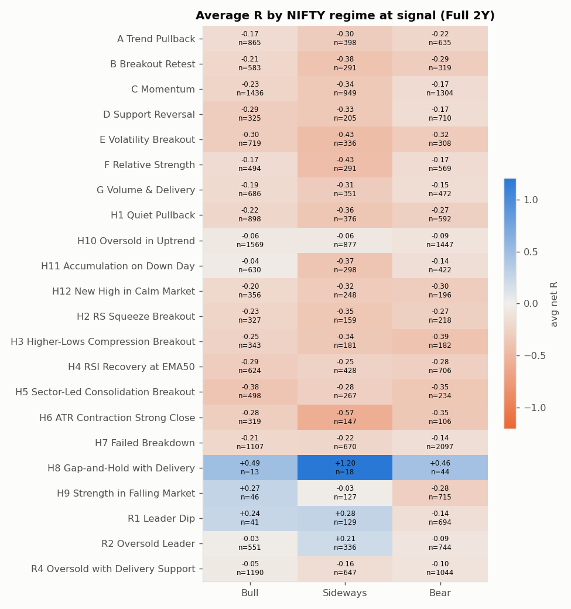
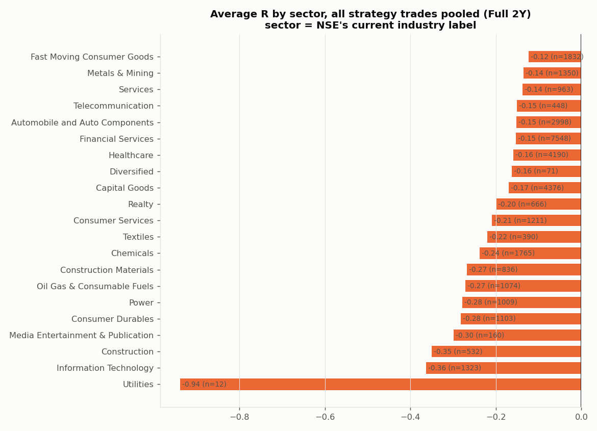
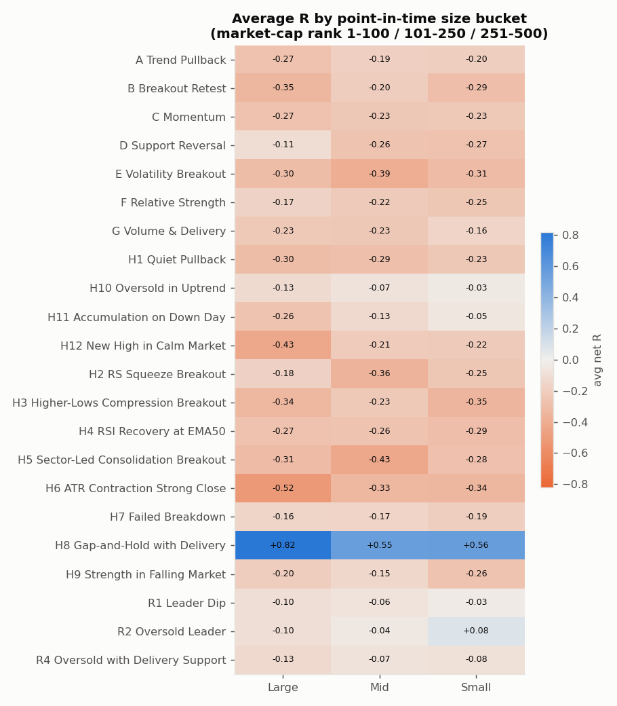
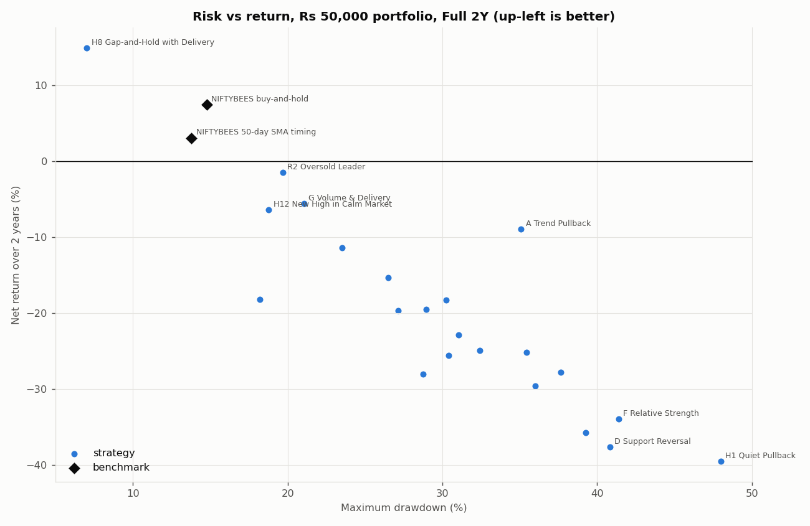
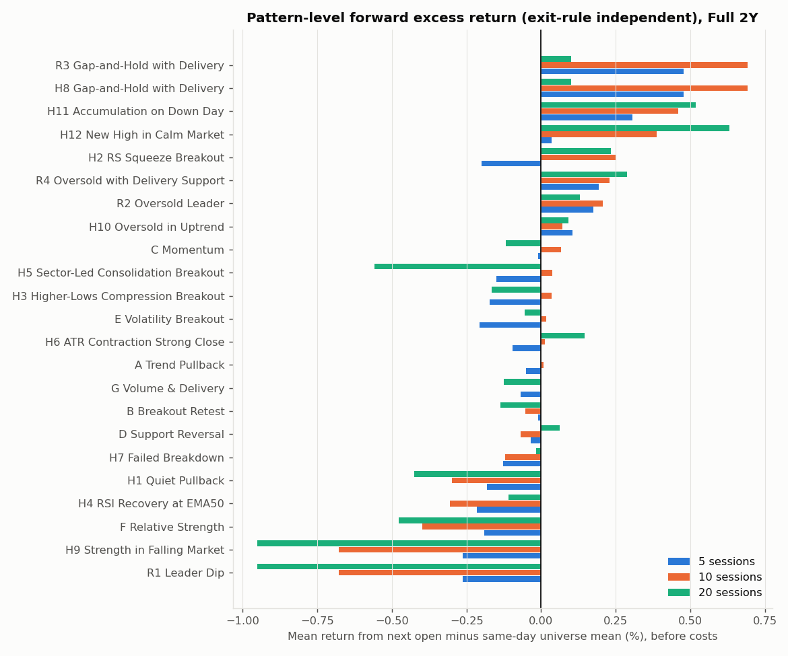

---

## Section 8 — Strategy ranking (out-of-sample first)

Sorted by classification, then by out-of-sample (Validation + Test) average R. Win rate is not a criterion.

| rank | strategy | class | OOS trades | OOS avg R (Val+Test) | OOS PF | Dev/Val/Test avg R | Walk-fwd avg R | Rs50k 2Y return % | Rs50k max DD % | Sharpe | size buckets +ve (OOS) | regimes +ve | avg R at 2x costs | avg R no costs |
|---|---|---|---|---|---|---|---|---|---|---|---|---|---|---|
| 1 | H8 Gap-and-Hold with Delivery | Weak or inconsistent | 45 | 0.78 | 3.44 | +0.44 / +0.55 / +1.09 | -0.65 | 14.87 | -7.03 | 1.07 | 3/3 | 3/3 | 0.48 | 0.79 |
| 2 | R2 Oversold Leader | Weak or inconsistent | 570 | -0.05 | 0.79 | +0.02 / -0.07 / -0.04 | -0.08 | -1.53 | -19.68 | 0.02 | 0/3 | 1/3 | -0.16 | 0.14 |
| 3 | R1 Leader Dip | Weak or inconsistent | 450 | -0.17 | 0.36 | +0.06 / -0.17 / -0.18 | -0.28 | -18.21 | -18.21 | -1.77 | 0/3 | 2/3 | -0.21 | 0.07 |
| 4 | H7 Failed Breakdown | Failed | 1597 | -0.06 | 1.01 | -0.26 / +0.12 / -0.23 | -0.13 | -27.76 | -37.65 | -1.06 | 1/3 | 0/3 | -0.31 | -0.02 |
| 5 | R4 Oversold with Delivery Support | Failed | 1043 | -0.08 | 0.65 | -0.10 / -0.09 / -0.08 | -0.12 | -24.93 | -32.41 | -0.70 | 0/3 | 0/3 | -0.23 | 0.03 |
| 6 | H10 Oversold in Uptrend | Failed | 1402 | -0.08 | 0.65 | -0.07 / -0.07 / -0.09 | -0.14 | -19.66 | -27.15 | -0.57 | 0/3 | 0/3 | -0.21 | 0.06 |
| 7 | F Relative Strength | Failed | 499 | -0.09 | 0.86 | -0.31 / +0.10 / -0.27 | -0.13 | -33.92 | -41.40 | -1.15 | 1/3 | 0/3 | -0.35 | -0.09 |
| 8 | G Volume & Delivery | Failed | 605 | -0.09 | 0.87 | -0.28 / +0.04 / -0.25 | -0.16 | -5.62 | -21.07 | -0.13 | 0/3 | 0/3 | -0.35 | -0.05 |
| 9 | C Momentum | Failed | 1568 | -0.11 | 0.88 | -0.33 / -0.05 / -0.19 | -0.13 | -19.52 | -28.96 | -0.52 | 0/3 | 0/3 | -0.37 | -0.09 |
| 10 | H11 Accumulation on Down Day | Failed | 511 | -0.12 | 0.89 | -0.16 / -0.06 / -0.21 | -0.16 | -18.26 | -30.24 | -0.57 | 0/3 | 0/3 | -0.31 | 0.03 |
| 11 | H2 RS Squeeze Breakout | Failed | 249 | -0.17 | 0.76 | -0.32 / +0.13 / -0.36 | -0.17 | -25.16 | -35.44 | -0.63 | 0/3 | 0/3 | -0.40 | -0.12 |
| 12 | H5 Sector-Led Consolidation Breakout | Failed | 461 | -0.21 | 0.68 | -0.46 / -0.30 / -0.11 | -0.13 | -35.75 | -39.26 | -1.60 | 0/3 | 0/3 | -0.48 | -0.19 |
| 13 | D Support Reversal | Failed | 496 | -0.22 | 0.75 | -0.24 / -0.08 / -0.29 | -0.22 | -37.62 | -40.82 | -1.86 | 0/3 | 0/3 | -0.38 | -0.06 |
| 14 | A Trend Pullback | Failed | 739 | -0.23 | 0.68 | -0.21 / -0.09 / -0.35 | -0.17 | -8.96 | -35.08 | -0.20 | 0/3 | 0/3 | -0.35 | -0.05 |
| 15 | E Volatility Breakout | Failed | 511 | -0.23 | 0.66 | -0.40 / -0.08 / -0.32 | -0.17 | -11.41 | -23.52 | -0.32 | 0/3 | 0/3 | -0.47 | -0.18 |
| 16 | H12 New High in Calm Market | Failed | 421 | -0.23 | 0.68 | -0.29 / -0.06 / -0.43 | -0.18 | -6.40 | -18.78 | -0.19 | 0/3 | 0/3 | -0.39 | -0.12 |
| 17 | H1 Quiet Pullback | Failed | 742 | -0.24 | 0.66 | -0.28 / -0.15 / -0.31 | -0.18 | -39.45 | -47.99 | -1.27 | 0/3 | 0/3 | -0.40 | -0.11 |
| 18 | H4 RSI Recovery at EMA50 | Failed | 651 | -0.26 | 0.65 | -0.29 / -0.06 / -0.37 | -0.20 | -25.56 | -30.42 | -0.93 | 0/3 | 0/3 | -0.41 | -0.12 |
| 19 | B Breakout Retest | Failed | 507 | -0.29 | 0.51 | -0.27 / -0.21 / -0.37 | -0.14 | -22.89 | -31.04 | -0.76 | 0/3 | 0/3 | -0.41 | -0.13 |
| 20 | H3 Higher-Lows Compression Breakout | Failed | 296 | -0.29 | 0.60 | -0.32 / -0.32 / -0.24 | -0.13 | -28.04 | -28.74 | -1.05 | 0/3 | 0/3 | -0.43 | -0.15 |
| 21 | H6 ATR Contraction Strong Close | Failed | 190 | -0.29 | 0.65 | -0.41 / -0.25 / -0.33 | -0.17 | -29.58 | -36.01 | -1.32 | 0/3 | 0/3 | -0.50 | -0.21 |
| 22 | H9 Strength in Falling Market | Failed | 447 | -0.29 | 0.67 | -0.14 / -0.08 / -0.69 | -0.28 | -15.35 | -26.50 | -0.31 | 0/3 | 1/3 | -0.36 | -0.05 |

Classification detail (Holm-adjusted p-value of the Development edge, walk-forward OOS):

| strategy | variant | round | classification | reason | holm_p | wf_trades | wf_avg_R | wf_R_lo90 | templates_chosen |
|---|---|---|---|---|---|---|---|---|---|
| A Trend Pullback | base | Round 1 (pre-registered) | Failed | did not advance from Development (negative) | 1.000 | 1,741 | -0.172 | -0.222 | E1,E2,E3 |
| A Trend Pullback | M | Round 1 (pre-registered) | Failed | did not advance from Development (negative) | 1.000 | 864.000 | -0.111 | -0.142 | E3 |
| B Breakout Retest | base | Round 1 (pre-registered) | Failed | did not advance from Development (negative) | 1.000 | 1,205 | -0.142 | -0.171 | E3 |
| B Breakout Retest | M | Round 1 (pre-registered) | Failed | did not advance from Development (negative) | 1.000 | 725.000 | -0.150 | -0.190 | E3 |
| C Momentum | base | Round 1 (pre-registered) | Failed | did not advance from Development (negative) | 1.000 | 3,955 | -0.134 | -0.166 | E2,E3 |
| C Momentum | M | Round 1 (pre-registered) | Failed | did not advance from Development (negative) | 1.000 | 2,237 | -0.128 | -0.160 | E1,E3 |
| D Support Reversal | base | Round 1 (pre-registered) | Failed | did not advance from Development (negative) | 1.000 | 1,000 | -0.224 | -0.374 | E1,E2,E3 |
| D Support Reversal | M | Round 1 (pre-registered) | Failed | did not advance from Development (negative) | 1.000 | 51.000 | -0.518 | -0.730 | E1,E2,E3 |
| E Volatility Breakout | base | Round 1 (pre-registered) | Failed | did not advance from Development (negative) | 1.000 | 1,177 | -0.173 | -0.215 | E1,E3 |
| E Volatility Breakout | M | Round 1 (pre-registered) | Failed | did not advance from Development (negative) | 1.000 | 743.000 | -0.154 | -0.202 | E1,E3 |
| F Relative Strength | base | Round 1 (pre-registered) | Failed | did not advance from Development (negative) | 1.000 | 1,111 | -0.133 | -0.183 | E2,E3 |
| F Relative Strength | M | Round 1 (pre-registered) | Failed | did not advance from Development (negative) | 1.000 | 472.000 | -0.109 | -0.146 | E1,E3 |
| G Volume & Delivery | base | Round 1 (pre-registered) | Failed | did not advance from Development (negative) | 1.000 | 1,346 | -0.162 | -0.213 | E1,E2,E3 |
| G Volume & Delivery | M | Round 1 (pre-registered) | Failed | did not advance from Development (negative) | 1.000 | 752.000 | -0.094 | -0.136 | E1,E3 |
| H1 Quiet Pullback | base | Round 1 (pre-registered) | Failed | did not advance from Development (negative) | 1.000 | 1,807 | -0.175 | -0.229 | E1,E2,E3 |
| H1 Quiet Pullback | M | Round 1 (pre-registered) | Failed | did not advance from Development (negative) | 1.000 | 971.000 | -0.152 | -0.218 | E1,E3 |
| H2 RS Squeeze Breakout | base | Round 1 (pre-registered) | Failed | did not advance from Development (negative) | 1.000 | 549.000 | -0.168 | -0.244 | E1,E3 |
| H2 RS Squeeze Breakout | M | Round 1 (pre-registered) | Failed | did not advance from Development (negative) | 1.000 | 266.000 | -0.056 | -0.130 | E1,E3 |
| H3 Higher-Lows Compression Breakout | base | Round 1 (pre-registered) | Failed | did not advance from Development (negative) | 1.000 | 627.000 | -0.128 | -0.162 | E3 |
| H3 Higher-Lows Compression Breakout | M | Round 1 (pre-registered) | Failed | did not advance from Development (negative) | 1.000 | 406.000 | -0.131 | -0.169 | E1,E3 |
| H4 RSI Recovery at EMA50 | base | Round 1 (pre-registered) | Failed | did not advance from Development (negative) | 1.000 | 1,507 | -0.196 | -0.264 | E2,E3 |
| H4 RSI Recovery at EMA50 | M | Round 1 (pre-registered) | Failed | did not advance from Development (negative) | 1.000 | 586.000 | -0.214 | -0.296 | E1,E3 |
| H5 Sector-Led Consolidation Breakout | base | Round 1 (pre-registered) | Failed | did not advance from Development (negative) | 1.000 | 943.000 | -0.133 | -0.171 | E1,E3 |
| H5 Sector-Led Consolidation Breakout | M | Round 1 (pre-registered) | Failed | did not advance from Development (negative) | 1.000 | 608.000 | -0.128 | -0.174 | E1,E3 |
| H6 ATR Contraction Strong Close | base | Round 1 (pre-registered) | Failed | did not advance from Development (negative) | 1.000 | 438.000 | -0.168 | -0.220 | E1,E3 |
| H6 ATR Contraction Strong Close | M | Round 1 (pre-registered) | Failed | did not advance from Development (negative) | 1.000 | 284.000 | -0.158 | -0.216 | E1,E3 |
| H7 Failed Breakdown | base | Round 1 (pre-registered) | Failed | did not advance from Development (negative) | 1.000 | 3,393 | -0.134 | -0.215 | E1,E2,E3 |
| H7 Failed Breakdown | M | Round 1 (pre-registered) | Failed | did not advance from Development (negative) | 1.000 | 1,163 | -0.117 | -0.158 | E1,E3 |
| H8 Gap-and-Hold with Delivery | base | Round 1 (pre-registered) | Weak or inconsistent | did not advance from Development (edge interval crosses 0 or n<100) | 1.000 | 2.000 | -0.654 |  | E2 |
| H8 Gap-and-Hold with Delivery | M | Round 1 (pre-registered) | Weak or inconsistent | did not advance from Development (edge interval crosses 0 or n<100) | 1.000 |  |  |  | nan |
| H9 Strength in Falling Market | base | Round 1 (pre-registered) | Failed | did not advance from Development (negative) | 1.000 | 667.000 | -0.284 | -0.445 | E1,E2,E3 |
| H9 Strength in Falling Market | M | Round 1 (pre-registered) | Failed | did not advance from Development (negative) | 1.000 | 0.000 |  |  | nan |
| H10 Oversold in Uptrend | base | Round 1 (pre-registered) | Failed | did not advance from Development (negative) | 0.000 | 3,253 | -0.143 | -0.199 | E1,E2,E3 |
| H10 Oversold in Uptrend | M | Round 1 (pre-registered) | Failed | did not advance from Development (negative) | 1.000 | 1,344 | -0.129 | -0.199 | E1,E3 |
| H11 Accumulation on Down Day | base | Round 1 (pre-registered) | Failed | did not advance from Development (negative) | 0.333 | 1,160 | -0.157 | -0.230 | E1,E2,E3 |
| H11 Accumulation on Down Day | M | Round 1 (pre-registered) | Failed | did not advance from Development (negative) | 1.000 | 609.000 | -0.165 | -0.284 | E1,E2,E3 |
| H12 New High in Calm Market | base | Round 1 (pre-registered) | Failed | did not advance from Development (negative) | 1.000 | 811.000 | -0.178 | -0.254 | E1,E3 |
| H12 New High in Calm Market | M | Round 1 (pre-registered) | Failed | did not advance from Development (negative) | 1.000 | 548.000 | -0.111 | -0.144 | E3 |
| R1 Leader Dip | base | Round 2 (post-hoc) | Weak or inconsistent | advanced, failed Validation | 0.008 | 667.000 | -0.284 | -0.445 | E1,E2,E3 |
| R2 Oversold Leader | base | Round 2 (post-hoc) | Weak or inconsistent | advanced, failed Validation | 0.000 | 1,357 | -0.083 | -0.143 | E1,E2,E3 |
| R3 Gap-and-Hold with Delivery | base | Round 2 (post-hoc) | Weak or inconsistent | did not advance from Development (edge interval crosses 0 or n<100) | 0.043 | 2.000 | -0.654 |  | E2 |
| R4 Oversold with Delivery Support | base | Round 2 (post-hoc) | Failed | did not advance from Development (negative) | 0.000 | 2,409 | -0.121 | -0.194 | E1,E2,E3 |

**Classification counts:** Strong historical evidence — 0 · Promising — 0 · Weak or inconsistent — see table · Failed — the rest.

---

## Section 9 — Failed strategies and why

- **Breakouts (B, E, H2, H3, H5, H6, H12):** −0.26R to −0.37R per trade, negative even before costs. In a market that
  reversed repeatedly (VIX spikes Apr 2025, Mar 2026, Oct 2026), breakouts were followed by pullbacks to the stop.
- **Trend pullbacks (A, H1, H4):** the "pullback" usually continued; RSI 40–60 and EMA-touch rules bought falling stocks in
  Bear regimes (43% of sessions).
- **Momentum / relative strength (C, F):** strong stocks mean-reverted within the 20-session window; a ~33% win rate
  was not offset by the size of the wins.
- **Support reversal and failed breakdown (D, H7):** D was negative in every period; H7 was positive only in Validation.
- **Delivery-only signals (G, H11, R4):** high delivery % alone did not predict returns; it helped only combined with a
  held gap (H8).
- **Market filter (all "M" variants):** buying only when NIFTY > SMA50 and breadth ≥ 50% made results worse — it entered
  after rallies that then reversed.
- **R1 Leader Dip:** positive in Development, failed Validation — a typical post-hoc false positive.

---

## Section 10 — Recommendations

1. **Do not trade any of these strategies with real money on this evidence.**
2. **Paper-trade Gap-and-Hold with Delivery** using the app's new *Research watch* page
   (`php artisan research:scan` after 18:00 IST). Review after ≥ 40 closed, on-time signals (~12–15 months at its frequency):
   continue only if average R > 0 after costs and the result is not one or two clustered days.
3. Keep Oversold Leader in research: re-test it in the next rising-market year with the same rules.
4. At ₹50,000, use a zero-brokerage delivery broker: brokerage alone cost ~0.04R per trade here.
5. The existing app's swing strategies (trend pullback, breakout, momentum, RSI recovery) belong to rule families that
   failed here on official, survivorship-free data — treat their signals as unvalidated. (The app's exact MA-trend rule
   was not re-tested; see Limitations.)

---

## Section 11 — Limitations

- **Short history.** Two years, one market character (choppy, mostly falling-to-flat). A strategy that failed here may work
  in a trending bull market and vice versa. Development/Validation/Test are ~300/100/100 sessions; Test is small.
- **Multiple testing.** 42 rules were run. Round 2 was post-hoc and Round 1's printed "Full 2Y" tables included the Test period,
  so Round 2's Test evidence is not a clean holdout (disclosed in the pre-registration addendum).
- **Open trades at the end** (signals in the last 20 sessions) are marked to the 25 Nov 2026 close and flagged `open_at_end`.
- **Universe.** Size buckets use NSE's daily market-cap file (company level, not free float); not the official Nifty index
  membership history, which NSE does not publish in machine-readable form. Sector labels are today's NSE industry
  classification (638 universe stocks, 55 without a label).
- **Prices.** Split/bonus adjusted; **dividends not adjusted** (price return only — slightly understates long returns).
  Demergers break the series (no estimated adjustment); 5 universe stocks affected. Rights issues not adjusted.
- **Execution.** Daily bars cannot show the intraday order of stop and target (stop assumed first). Circuit-locked bars block
  exits only when NSE flagged a lower-band hit and high = low. Slippage is a fixed assumption (10 bps, 25 bps on stops);
  2× costs + 25 bps is shown. Delivery charges use a ₹10,000 notional for trade-level stats; the portfolio uses actual rupees.
- **Special sessions** (Muhurat, Budget Saturday, DR drills) are included as trading days because NSE published bars for them.
- **Delivery %** is a research feature; it does not prove who bought or why.
- The app's own strategy implementations were not re-run here; A–G are conventional definitions of the same ideas.
- **No intraday data** was used; 4-hour bars were not available from an official source.
- Past results do not predict future results.

---

## Appendix — files and reproduction

- `research/PREREGISTRATION.md` — rules fixed before results (+ Round 2 addendum)
- `research/strategy_comparison.csv` — every strategy × variant × period, all metrics, edge, bootstrap bounds, classification, walk-forward
- `research/backtest_trades.csv` — every simulated trade (entry, stop, target, exit, reason, R, costs, regime, sector, bucket)
- `research/monthly_performance.csv` — ₹50k account monthly returns per strategy and benchmark
- `research/pattern_discovery.csv` — frequency and forward excess returns for every pattern and period
- `research/output/` — portfolio results, cost sensitivity, walk-forward trades, ranking, robustness checks
- `research/charts/` — all charts
- Reproduce: see `research/README.md`.
